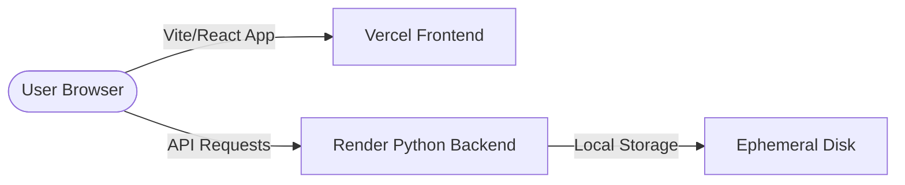

# RMS Face AI — 100% Free Production Deployment Guide

This guide details how to deploy the React Web Frontend to **Vercel (Free Tier)** and the Python Flask Backend to **Render (Free Tier)** without paying anything.

---

## Architecture Overview

- **Frontend**: Hosted on Vercel's edge network (free sub-domain: `your-app.vercel.app`).
- **Backend**: Hosted on Render's Python environment (free sub-domain: `rms-backend.onrender.com`).
  - *Memory Optimization*: Uses model lazy-loading (`LAZY_LOAD_MODELS=true`) to fit within the 512MB RAM free tier limit.
  - *Sleep Cycle*: Suspends after 15 minutes of inactivity. The first request after a sleep takes ~30-60s to wake up (cold start).
  - *Storage*: Render Free tier disk is ephemeral. Uploaded photos and newly trained models are reset on redeploy/restarts.

---

## Step 1: Deploy Backend to Render (Free)

1. Create a free account at [Render](https://render.com/).
2. Push your project to a GitHub or GitLab repository.
3. Click **New +** → **Web Service** in the Render Dashboard.
4. Connect your Git repository.
5. Configure the Web Service settings:
   - **Name**: `rms-face-ai-backend` (or custom name)
   - **Environment**: `Python`
   - **Region**: Select region closest to your users
   - **Branch**: `main` (or your development branch)
   - **Build Command**: `pip install -r requirements.txt`
   - **Start Command**: `cd backend && gunicorn server:app --bind 0.0.0.0:$PORT --timeout 300 --workers 1`
   - **Instance Type**: `Free` ($0/month)
6. Expand **Advanced** and add the following **Environment Variables**:
   - `LAZY_LOAD_MODELS`: `true`
   - `STORAGE_DIR`: `/tmp` (or leave empty to default to project folder)
   - `FRONTEND_URL`: `https://YOUR_APP_NAME.vercel.app` (Your Vercel URL - you can update this after Step 2)
7. Click **Create Web Service**. Wait for the build and deployment logs to finish.
8. Copy your Render Service URL (e.g., `https://rms-face-ai-backend.onrender.com`).

---

## Step 2: Deploy Frontend to Vercel (Free)

1. Create a free account at [Vercel](https://vercel.com/).
2. Click **Add New** → **Project** in the Vercel Dashboard.
3. Import your Git repository.
4. Configure the Project settings:
   - **Framework Preset**: `Vite` (automatically detected)
   - **Root Directory**: `frontend`
5. Expand **Environment Variables** and add:
   - **Key**: `VITE_API_URL`
   - **Value**: `https://YOUR_RENDER_URL.onrender.com/api` (The backend URL copied in Step 1 + `/api`)
6. Click **Deploy**. Vercel will build and host your site in less than a minute.
7. Note down your Vercel URL (e.g., `https://rms-face-ai.vercel.app`).

---

## Step 3: Link Them Together (CORS Setup)

Go back to your Render Dashboard for the backend service:
1. In settings, go to **Environment Variables**.
2. Update the `FRONTEND_URL` environment variable value to your Vercel URL: `https://YOUR_APP_NAME.vercel.app`.
3. Save changes. Render will automatically redeploy the backend with the new CORS permissions.

---

## Troubleshooting

### Cold Starts
Since Render's free tier spins down after 15 minutes of inactivity, you might experience a 30-60 second wait when loading the dashboard or test page for the first time. This is expected.

### 502/504 Gateway Timeouts
ML inference and training pipelines can take time. We have configured gunicorn with a `--timeout 300` flag to allow up to 5 minutes for processing. However, Render's free tier load balancer can occasionally timeout if training takes longer. Use lower epoch counts (e.g., 5 epochs) when training on the free tier.

### Lost Data
Any uploaded person profiles and SOTA model checkpoints are stored locally on the container. Because Render free tier containers are ephemeral, this data is wiped whenever Render restarts or redeploys. For a permanent portfolio setup, you can add a Render Persistent Disk (under the Web Service's disk settings tab) for a nominal monthly cost, or keep using the ephemeral disk for free demos.
