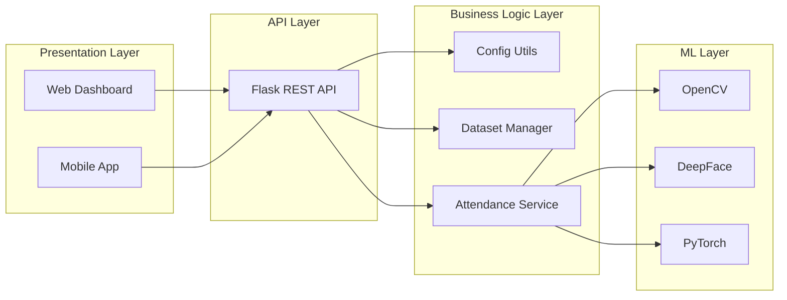
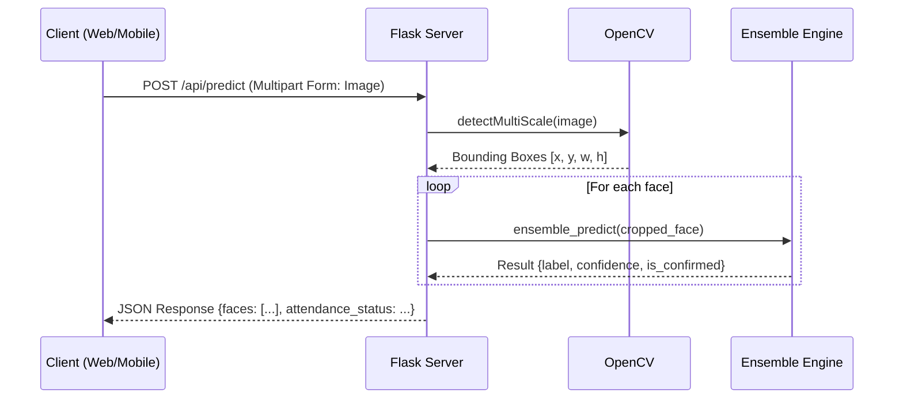
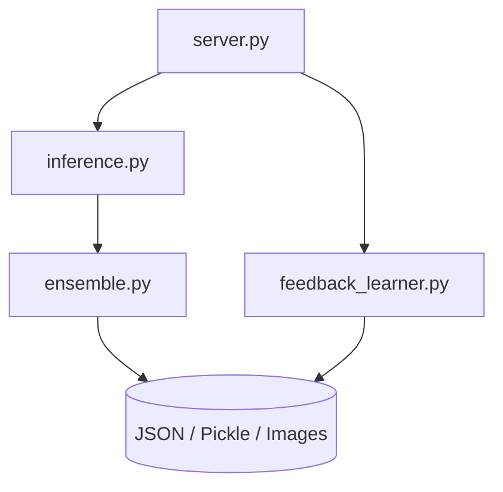

# 01 Architecture

## Overall Architecture
The RMS Face AI project implements a decoupled, edge-first architecture. It separates the presentation layers (Web and Mobile) from the intensive computational layers (Flask API and ML pipelines). Because facial recognition involves heavy matrix multiplication and deep learning forward passes, the backend is designed to run on a dedicated edge device or local server, while thin clients simply capture images and present results.

## Backend Architecture
The backend is a synchronous Flask application serving as a wrapper around several heavy computer vision libraries. 
- **Framework:** Flask (chosen for native, synchronous Python AI library compatibility).
- **Face Detection:** OpenCV with Haar Cascades is utilized as a fast, lightweight first pass to locate faces in an image stream before passing cropped artifacts to heavier neural networks.
- **AI Core:** `ensemble.py` acts as the orchestrator for the ML layer, combining outputs from K-Nearest Neighbors (KNN) searches on FaceNet512 embeddings and forward passes on a fine-tuned MobileNetV2 architecture.

## Frontend Architecture
The web frontend is a Single Page Application (SPA).
- **Bundler:** Vite (for rapid HMR and optimized production builds).
- **Framework:** React 18 using purely functional components and Hooks.
- **Styling:** Vanilla CSS leveraging a robust CSS-variable design system to implement "Premium AI SaaS Glassmorphism" (translucent cards, backdrop blurs, fluid gradients).
- **Communication:** Axios for HTTP requests, utilizing a centralized `config.js` for dynamic backend URL resolution.

## Mobile Architecture
The mobile application brings the system's capabilities to security personnel roaming the physical premises.
- **Framework:** React Native bootstrapped via Expo.
- **Navigation:** `@react-navigation/native-stack` and `@react-navigation/bottom-tabs` for seamless UI transitions.
- **Hardware Integration:** `expo-camera` is heavily utilized via the `CameraCaptureScreen.js` modal to safely capture frames without UI bleed-through or bottom-tab obstruction.
- **Network Resilience:** Mobile devices inherently face network drops. The `api.js` service layer includes strict timeouts, base64-to-blob normalization for the Expo web simulator, and automatic `.jpg` extension injection for proper backend mime-type validation.

## AI Model Architecture
The AI pipeline is an Ensemble model to balance speed and accuracy.
1. **The Structural Index (DeepFace):** Fast, scalable. When an image arrives, DeepFace extracts a high-dimensional vector (embedding). Scikit-Learn's KNN calculates the Euclidean distance to all known vectors. If `distance < CONFIRM_THRESHOLD` (e.g., `0.55`), a match is flagged.
2. **The Deep Classifier (MobileNetV2):** Accurate, slow to train. A PyTorch MobileNetV2 model fine-tuned on the specific local dataset acts as a secondary validator, classifying the image against known classes.

## Communication Flow
All communication between clients and the backend occurs via JSON over HTTP/1.1 REST. 

## Request Lifecycle
1. **Ingress:** A request hits `server.py` routing.
2. **CORS & Validation:** The Flask `CORS` middleware allows the request if the origin is trusted. The file is validated using `_allowed_file()` to ensure it is a safe image extension.
3. **Processing:** The image bytes are read into an OpenCV `numpy` array.
4. **Execution:** Feature extraction and inference occur in `inference.py`.
5. **Egress:** The `numpy` arrays, Python floats, and boolean values are safely serialized to standard JSON and returned to the client with a `200 OK` status.

## Component Diagram

## Service Responsibilities
- **`server.py`**: API routing, HTTP validation, CORS, error handling.
- **`inference.py`**: Business logic for predictions, bounding box coordinate math, and converting ML results into API-friendly JSON shapes.
- **`ensemble.py`**: The mathematical bridge; averages confidence scores and applies the logic gate that determines if a face is "CONFIRMED".
- **`feedback_learner.py`**: Manages the human-in-the-loop correction system. Rewrites the dataset and triggers `add_person_utils.py` when false predictions are manually corrected.
