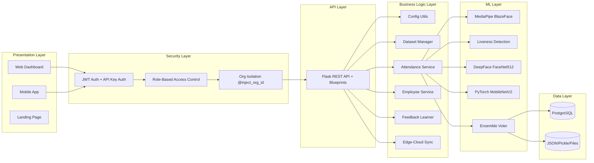
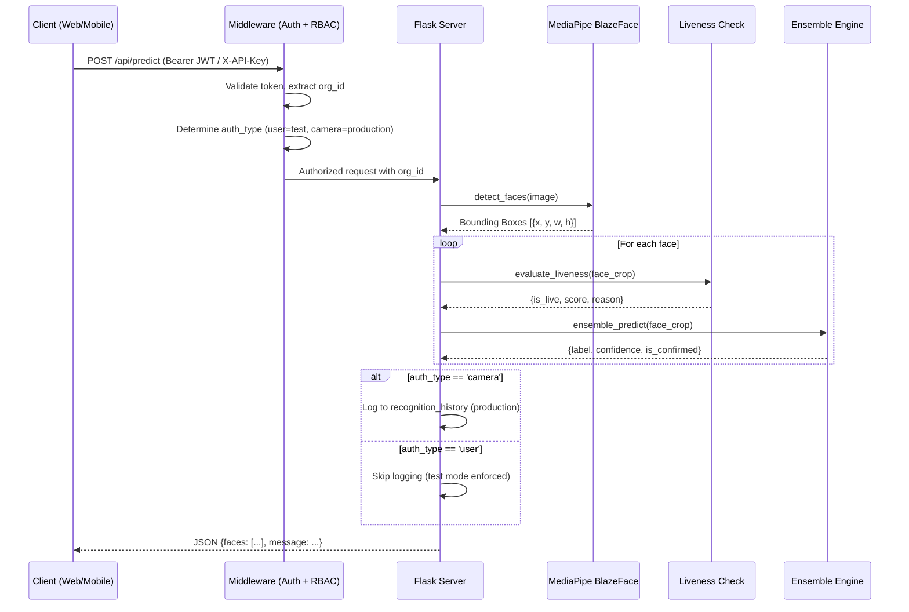
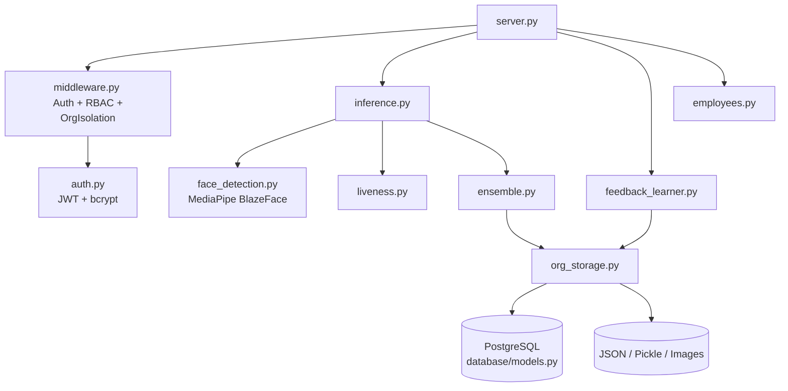

# 01 Architecture

## Overall Architecture
RMS Face AI implements a decoupled, multi-layered architecture with strict security enforcement at every tier. The system separates presentation (Web, Mobile, Landing Page), authentication (JWT for humans, API keys for cameras), business logic (Flask API with RBAC middleware), ML inference (MediaPipe, DeepFace, PyTorch), and data persistence (PostgreSQL or local file fallback) into discrete, independently testable layers.

## Backend Architecture
The backend is a Flask application serving as the security gateway, orchestration layer, and inference engine for the entire platform.

- **Framework:** Flask with Blueprint-based route organization.
- **Authentication:** Dual-mode auth via `middleware.py`:
  - `@require_auth`: Validates JWT Bearer tokens for human users (dashboard, mobile).
  - `@require_api_key`: Validates `X-API-Key` headers for edge cameras.
  - `@require_api_key_or_auth`: Hybrid decorator for endpoints like `/api/predict` that accept either auth method.
- **Authorization:** `@require_role(*roles)` enforces a strict role hierarchy: `platform_owner > org_admin > manager > viewer > kiosk`.
- **Tenant Isolation:** `@inject_org_id` extracts the authenticated user's `org_id` from the JWT and passes it to every route handler — no route ever trusts client-provided org IDs.
- **Face Detection:** MediaPipe BlazeFace deep learning model for robust multi-angle face detection, replacing the legacy Haar Cascade classifier.
- **AI Core:** `ensemble.py` orchestrates the ML pipeline, combining KNN searches on FaceNet512 embeddings (with Test-Time Augmentation) and forward passes on a fine-tuned MobileNetV2 architecture through a 4-gate confirmation pipeline.
- **Liveness Detection:** `liveness.py` evaluates facial texture, edge density, and color variance to reject spoofing attacks.

## Frontend Architecture
The web frontend is a Single Page Application (SPA) with a full authentication flow.

- **Bundler:** Vite (for rapid HMR and optimized production builds).
- **Framework:** React 18 using functional components and Hooks.
- **Authentication:** `AuthContext.jsx` manages JWT token storage, automatic refresh, and API client configuration with Bearer token injection.
- **Styling:** Vanilla CSS with a comprehensive CSS-variable design system implementing "Premium AI SaaS Dark Mode" (glassmorphism, liquid glass effects, backdrop blurs, fluid gradients).
- **Animations:** Framer Motion for page transitions and GSAP for scroll-driven landing page animations.
- **Communication:** Axios via a centralized `apiClient` that automatically attaches JWT tokens and handles 401 token expiration redirects.

## Mobile Architecture
The mobile application provides portable biometric scanning for security personnel.

- **Framework:** React Native bootstrapped via Expo.
- **Navigation:** `@react-navigation/native-stack` and `@react-navigation/bottom-tabs`.
- **UI Design:** Liquid glass morphism with frosted glass effects, vibrant gradients, and micro-animations.
- **Hardware Integration:** `expo-camera` via the `CameraCaptureScreen.js` modal for safe frame capture.
- **Network Resilience:** Strict timeouts, base64-to-blob normalization, and automatic `.jpg` extension injection.

## AI Model Architecture
The AI pipeline is a multi-stage ensemble to balance speed, accuracy, and security.

1. **Face Detection (MediaPipe BlazeFace):** Deep learning face detector that handles frontal, profile, and partially occluded faces. Outputs precise bounding boxes with face mesh landmarks.
2. **Liveness Detection:** Analyzes edge density (Laplacian variance), color variance, and texture patterns to detect printed photos or screen replays. Rejects non-live faces before ML inference.
3. **Structural Index (DeepFace/FaceNet512 + TTA):** Extracts 512-dimensional embeddings using Test-Time Augmentation (5 augmented variants averaged) for robust vector similarity matching via KNN.
4. **Deep Classifier (MobileNetV2):** Fine-tuned CNN for categorical identity confirmation.
5. **Ensemble Voter:** Combines outputs through a 4-gate pipeline: distance threshold → binary classifier → adaptive threshold → confidence level.

## Communication Flow

## Request Lifecycle
1. **Ingress:** A request hits `server.py` routing.
2. **Authentication:** `middleware.py` validates the JWT Bearer token or API Key header. Sets `g.current_user` or `g.current_camera`.
3. **Authorization:** `@require_role` checks the user's role against the role hierarchy.
4. **Tenant Isolation:** `@inject_org_id` extracts `org_id` from the authenticated identity and passes it to the route handler.
5. **Processing:** The image is validated, decoded, and passed to MediaPipe for face detection.
6. **Liveness Check:** Each detected face is evaluated for liveness before ML inference.
7. **Inference:** The ensemble pipeline runs FaceNet512 (KNN) + MobileNetV2 (SOTA) and applies the 4-gate confirmation logic.
8. **Logging:** If the request came from an API Key (camera), attendance is logged. If from a JWT (human), test mode is enforced.
9. **Egress:** Results are serialized to JSON and returned with appropriate HTTP status codes.

## Component Diagram

## Service Responsibilities
- **`server.py`**: API routing, HTTP validation, CORS, rate limiting, error handling, and route registration.
- **`middleware.py`**: JWT authentication (`@require_auth`), API key authentication (`@require_api_key`), dual-auth (`@require_api_key_or_auth`), RBAC (`@require_role`), and tenant isolation (`@inject_org_id`).
- **`auth.py`**: Password hashing (bcrypt), JWT access/refresh token creation and validation.
- **`inference.py`**: KNN vector matching, cosine distance calculations, TTA embedding generation, and CLAHE preprocessing.
- **`ensemble.py`**: Prediction voter; averages confidence scores and applies the 4-gate confirmation pipeline.
- **`face_detection.py`**: MediaPipe BlazeFace face detection with landmark-based pose estimation.
- **`liveness.py`**: Anti-spoofing checks using edge density, color variance, and texture analysis.
- **`feedback_learner.py`**: Human-in-the-loop correction system; rewrites dataset and re-indexes embeddings.
- **`org_storage.py`**: Per-organization file path resolution for multi-tenant data isolation.
- **`employees.py`**: Employee CRUD operations via SQLAlchemy (Blueprint).
- **`database/models.py`**: SQLAlchemy ORM models for all 8 database tables.
- **`database/db.py`**: Database session management with dual-mode support (PostgreSQL or None).
