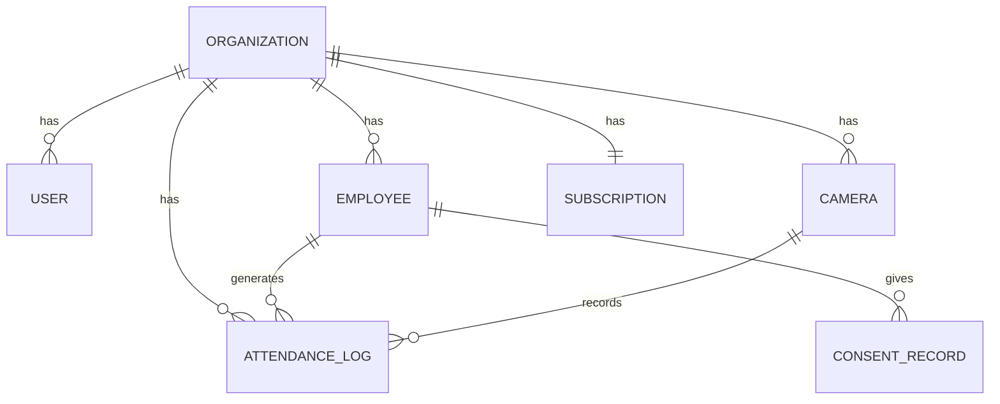

# 08 Database Architecture

## Overview
RMS Face AI implements a **Dual-Mode Data Architecture** supporting both cloud-hosted multi-tenant PostgreSQL and local single-tenant file-based storage. The system automatically selects the appropriate mode based on the `DATABASE_URL` environment variable.

## Dual-Mode Architecture

### Cloud Mode (Multi-Tenant PostgreSQL)
When `DATABASE_URL` is set, the system connects to a PostgreSQL database via SQLAlchemy ORM:
- Full multi-tenant isolation with `org_id` scoping on every query.
- 8 relational tables with proper foreign keys, indexes, and constraints.
- Alembic for schema versioning and migrations.
- Atomic transactions for attendance logging and employee management.

### Local Mode (Single-Tenant File Storage)
When `DATABASE_URL` is not set, the system falls back to file-based storage:
- `encodings.pickle` for KNN embeddings.
- `recognition_history.json` for detection logs.
- `config.json` for runtime configuration.
- OS file system for dataset storage.

The `database/db.py` module exposes `is_db_available()` which returns `True` only in cloud mode. All business logic checks this before attempting database operations.

---

## PostgreSQL Schema (8 Tables)

### 1. `organizations` — The Tenant
Every table in the system carries an `org_id` foreign key to this table. Each paying customer is one organization.

| Column | Type | Description |
|--------|------|-------------|
| `id` | `UUID (String 36)` | Primary key |
| `name` | `String(100)` | Organization display name |
| `slug` | `String(100)` | URL-safe unique identifier |
| `deployment_mode` | `Enum(cloud, local, hybrid)` | Deployment configuration |
| `plan_tier` | `Enum(starter, business, enterprise)` | Subscription plan |
| `confirm_threshold` | `Float` | Default recognition threshold (0.55) |
| `created_at` | `DateTime` | Registration timestamp |
| `updated_at` | `DateTime` | Last modification timestamp |

### 2. `users` — Dashboard Operators (Humans)
Human operators who log into the web dashboard or mobile app.

| Column | Type | Description |
|--------|------|-------------|
| `id` | `UUID` | Primary key |
| `org_id` | `UUID` | FK → organizations |
| `email` | `String(255)` | Login email (unique per org) |
| `password_hash` | `String(255)` | bcrypt-hashed password |
| `name` | `String(100)` | Display name |
| `role` | `Enum(platform_owner, org_admin, manager, viewer, kiosk)` | RBAC role |
| `is_active` | `Boolean` | Account enabled status |
| `last_login_at` | `DateTime` | Most recent login timestamp |

**Constraint:** `UNIQUE(org_id, email)` — two different orgs can have the same email.

### 3. `employees` — Faces Enrolled for Recognition
Individuals whose faces are enrolled for biometric identification.

| Column | Type | Description |
|--------|------|-------------|
| `id` | `UUID` | Primary key |
| `org_id` | `UUID` | FK → organizations |
| `name` | `String(100)` | Display name (used as folder name in dataset) |
| `employee_code` | `String(50)` | Optional HR employee code |
| `department` | `String(100)` | Department assignment |
| `email` | `String(255)` | Contact email |
| `status` | `Enum(active, terminated, suspended)` | Employment status |
| `image_count` | `Integer` | Number of enrolled reference images |
| `consent_given_at` | `DateTime` | Biometric consent timestamp |
| `consent_revoked_at` | `DateTime` | Consent revocation timestamp |

**Constraint:** `UNIQUE(org_id, name)` — unique employee names per org.

### 4. `cameras` — Physical Devices (Kiosks, Gates)
Edge devices that capture frames and submit `/api/predict` or `/api/sync` requests.

| Column | Type | Description |
|--------|------|-------------|
| `id` | `UUID` | Primary key |
| `org_id` | `UUID` | FK → organizations |
| `name` | `String(100)` | Camera display name |
| `location` | `String(255)` | Physical location description |
| `api_key` | `String(64)` | Unique API key for authentication (indexed) |
| `confirm_threshold_override` | `Float` | Optional per-camera threshold |
| `is_active` | `Boolean` | Camera enabled status |

### 5. `attendance_logs` — Check-in / Check-out Events
Timestamped biometric verification events.

| Column | Type | Description |
|--------|------|-------------|
| `id` | `UUID` | Primary key |
| `org_id` | `UUID` | FK → organizations |
| `employee_id` | `UUID` | FK → employees (nullable) |
| `camera_id` | `UUID` | FK → cameras (nullable) |
| `checkin_time` | `DateTime` | Event timestamp |
| `confidence` | `Float` | Recognition confidence score |
| `method` | `String(50)` | Inference method used |
| `status` | `Enum(on_time, late, early_departure, logged)` | Attendance classification |
| `prediction_label` | `String(100)` | ML-predicted identity label |
| `is_confirmed` | `Boolean` | Whether the 4-gate pipeline confirmed |
| `synced` | `Boolean` | Edge-cloud sync status |

**Indexes:** `(org_id, checkin_time)`, `(org_id, employee_id)`, `(synced)`.

### 6. `feedback_logs` — Human-in-the-Loop Correction Audit Trail
Records every correction submitted by operators.

| Column | Type | Description |
|--------|------|-------------|
| `id` | `UUID` | Primary key |
| `org_id` | `UUID` | FK → organizations |
| `prediction_id` | `String(20)` | Original prediction identifier |
| `predicted_name` | `String(100)` | ML's original prediction |
| `is_correct` | `Boolean` | Whether the prediction was correct |
| `correct_name` | `String(100)` | Operator-provided correct identity |
| `distance` | `Float` | Original cosine distance |
| `action_taken` | `String(50)` | Backend action (moved, deleted, etc.) |
| `model_version` | `String(50)` | Model version at time of prediction |

### 7. `subscriptions` — Billing & Plan Limits
Manages plan tiers and usage limits per organization.

| Column | Type | Description |
|--------|------|-------------|
| `id` | `UUID` | Primary key |
| `org_id` | `UUID` | FK → organizations (unique) |
| `plan_tier` | `Enum(starter, business, enterprise)` | Active plan |
| `max_employees` | `Integer` | Maximum enrolled employees (default 25) |
| `max_cameras` | `Integer` | Maximum connected cameras (default 1) |
| `status` | `Enum(active, trial, past_due, cancelled)` | Subscription state |
| `stripe_customer_id` | `String(255)` | Stripe integration reference |
| `stripe_subscription_id` | `String(255)` | Stripe subscription reference |
| `current_period_start` | `DateTime` | Billing period start |
| `current_period_end` | `DateTime` | Billing period end |

### 8. `consent_records` — Biometric Data Consent (BIPA / GDPR / DPDP)
Legal audit trail for biometric data collection consent.

| Column | Type | Description |
|--------|------|-------------|
| `id` | `UUID` | Primary key |
| `org_id` | `UUID` | FK → organizations |
| `employee_id` | `UUID` | FK → employees |
| `consented_by_user_id` | `UUID` | FK → users (who collected consent) |
| `consent_type` | `String(50)` | Type of consent (biometric_enrollment) |
| `consented_at` | `DateTime` | When consent was given |
| `revoked_at` | `DateTime` | When consent was revoked (nullable) |
| `ip_address` | `String(45)` | IP address at time of consent |

---

## Entity Relationship Diagram



---

## Single-Tenant File Storage (Fallback)

### KNN Index (`encodings.pickle`)
- **Location:** `backend/data/encodings.pickle` (global) or `backend/data/orgs/{org_id}/encodings.pickle` (multi-tenant).
- **Schema:** `{"names": ["John_Doe", ...], "encodings": [[0.45, 0.12, ... 512 floats], ...]}`
- **Query:** O(N) KNN scan (negligible for <10,000 embeddings).

### Recognition Log (`recognition_history.json`)
- **Location:** `backend/data/recognition_history.json`
- **Schema:** Flat JSON array of detection events.

### Application Config (`config.json`)
- **Location:** `backend/data/config.json`
- **Schema:** `{"CONFIRM_THRESHOLD": 0.55}`

---

## Migration Workflow (Alembic)
```bash
cd backend
alembic upgrade head        # Apply all pending migrations
alembic revision --autogenerate -m "description"  # Generate new migration
alembic downgrade -1        # Rollback one migration
```
