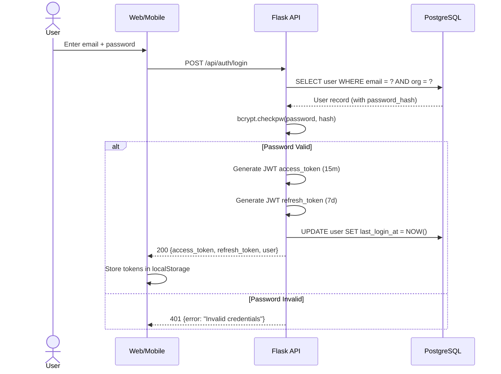
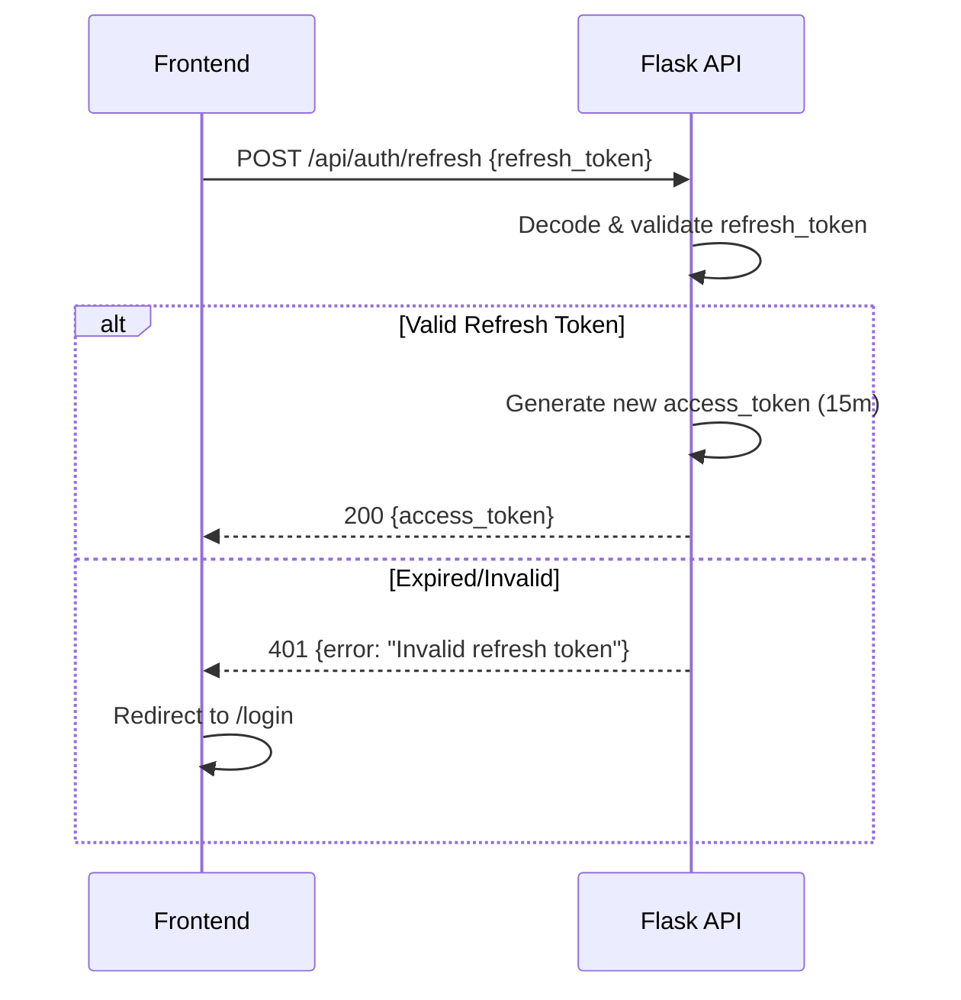

# 09 Authentication & Security

## Overview
RMS Face AI implements a comprehensive, production-grade security architecture with three distinct authentication mechanisms, role-based access control (RBAC), multi-tenant data isolation, and anti-spoofing protections at both the API and ML layers.

## Authentication Mechanisms

### 1. JWT Bearer Tokens (Human Users)
Used by the Web Dashboard and Mobile App for authenticating human operators.

- **Algorithm:** HS256 (HMAC-SHA256).
- **Secret:** Configured via `JWT_SECRET_KEY` environment variable.
- **Password Storage:** bcrypt with 12 salt rounds — passwords are never stored in plaintext.

#### Token Lifecycle
| Token | Expiry | Storage | Purpose |
|-------|--------|---------|---------|
| Access Token | 15 minutes | `localStorage` | Short-lived credential for API requests |
| Refresh Token | 7 days | `localStorage` | Long-lived token to obtain new access tokens |

#### Login Flow


#### Token Refresh Flow


#### Frontend Auto-Refresh (`AuthContext.jsx`)
The `AuthContext` wraps Axios with a response interceptor that:
1. Detects `401 Unauthorized` responses.
2. Automatically attempts token refresh using the stored refresh token.
3. Replays the original failed request with the new access token.
4. If refresh fails, clears tokens and redirects to `/login`.

### 2. API Key Authentication (Edge Cameras)
Used by physical cameras, kiosks, and gate devices for production attendance logging.

- **Header:** `X-API-Key: <64-char-key>`
- **Storage:** Each camera has a unique `api_key` column in the `cameras` database table (indexed, unique).
- **Validation:** `middleware.py` queries `Camera.api_key` to find the matching device and extracts `camera_id` and `org_id`.
- **Single-Tenant Fallback:** Uses `LOCAL_CAMERA_KEY` environment variable (default: `default-local-camera-key`).

### 3. Dual Authentication (`@require_api_key_or_auth`)
The `/api/predict` endpoint accepts **either** authentication method and enforces different behaviors:

| Auth Method | `g.auth_type` | `test_mode` | Attendance Logged? |
|-------------|---------------|-------------|-------------------|
| API Key (Camera) | `'camera'` | `False` (production) | ✅ Yes |
| JWT Bearer (Human) | `'user'` | `True` (forced) | ❌ No |

**Critical Security Rule:** The backend **ignores** any `test_mode` parameter sent by the client when a JWT token is used. This prevents employees from using tools like Postman to strip the test flag and forge attendance records.

## Role-Based Access Control (RBAC)

### Role Hierarchy
```
platform_owner > org_admin > manager > viewer > kiosk
```

| Role | Permissions |
|------|-------------|
| `platform_owner` | Full system access across all organizations |
| `org_admin` | Full access within their organization (user management, training, config) |
| `manager` | Employee management, attendance review, feedback submission |
| `viewer` | Read-only access to dashboards and attendance |
| `kiosk` | Inference-only access (camera/kiosk mode) |

### Enforcement
The `@require_role(*roles)` decorator checks:
1. That the user is authenticated (`g.current_user` exists).
2. That the user's role matches or exceeds the minimum required role.
3. Role hierarchy is respected — an `org_admin` can access any endpoint requiring `manager` or `viewer`.

## Multi-Tenant Data Isolation

### Backend Enforcement (`@inject_org_id`)
Every protected route uses the `@inject_org_id` decorator which:
1. Extracts `org_id` from the authenticated identity (`g.current_user` or `g.current_camera`).
2. Passes it as a keyword argument to the route handler.
3. **No route ever trusts a client-provided `org_id`** — the backend always overrides with the authenticated identity.

### Database Isolation
Every SQLAlchemy query is scoped by `org_id`:
```python
employees = session.query(Employee).filter_by(org_id=org_id).all()
```

### File System Isolation
`org_storage.py` routes data to per-org directories:
```
backend/data/orgs/{org_id}/encodings.pickle
backend/data/orgs/{org_id}/config.json
dataset_cleaned/orgs/{org_id}/{employee_name}/...
```

## Edge Camera Security

### API Key Assignment
1. Admin creates a camera via the dashboard.
2. System generates a unique 64-character API key.
3. The key is stored hashed in the `cameras.api_key` column.
4. Admin configures the physical camera to send `X-API-Key: <key>` on all requests.

### Identity Spoofing Prevention
When an edge camera sends logs via `/api/sync`:
- The backend validates the API key.
- **Ignores** any `org_id` or `camera_id` in the JSON payload.
- Overwrites with the authenticated camera's identity from the database.
- This prevents a compromised camera from logging attendance for a different branch or organization.

## Liveness Detection (Anti-Spoofing)
Beyond API-level security, the ML pipeline includes liveness detection to prevent physical presentation attacks:
- **Edge Density:** Laplacian variance analysis detects printed photos (flat texture).
- **Color Variance:** Detects uniform color blocks characteristic of screen displays.
- **Texture Analysis:** Frequency-domain analysis detects printing artifacts and moiré patterns.

## CORS Policy
- **Production:** Strictly restricted to the configured `FRONTEND_URL` origin.
- **Development:** Open CORS when `FRONTEND_URL` is not set.
- Prevents Cross-Site Request Forgery (CSRF) and rogue frontend injection.

## Network Level Security
```python
allowed_origins = [
    'http://localhost:5173',
    'http://127.0.0.1:5173',
]
frontend_url = os.environ.get('FRONTEND_URL')
if frontend_url:
    allowed_origins.append(frontend_url.rstrip('/'))
    CORS(app, origins=allowed_origins)
else:
    CORS(app)  # Local Dev Mode
```

## Data Privacy
- All embeddings in `encodings.pickle` are 512-dimensional mathematical vectors that **cannot** be reverse-engineered back into human faces.
- The `/dataset_cleaned` directory holds raw JPEG images and must be encrypted at rest on production servers.
- The `consent_records` database table provides a full legal audit trail for biometric data consent (BIPA/GDPR/DPDP compliance).

## Security Checklist
- [x] JWT authentication with bcrypt password hashing
- [x] Role-based access control with hierarchical roles
- [x] API key authentication for edge cameras
- [x] Backend-enforced test mode for human users on `/api/predict`
- [x] Identity spoofing prevention on `/api/sync`
- [x] Multi-tenant data isolation via `@inject_org_id`
- [x] Liveness detection (anti-spoofing) in ML pipeline
- [x] CORS enforcement in production
- [x] Rate limiting on API endpoints
- [x] Biometric consent audit trail
