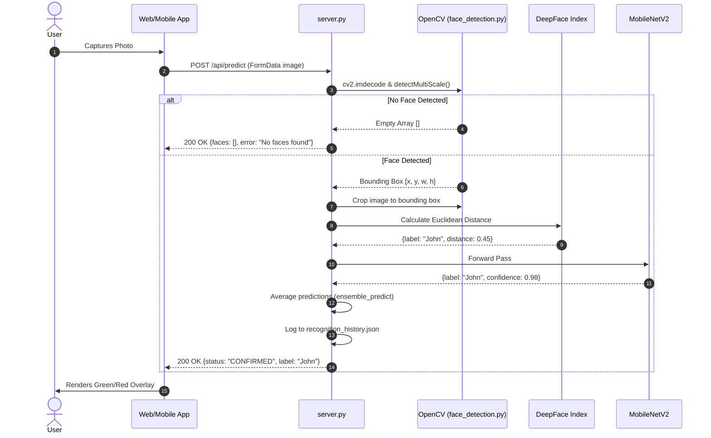
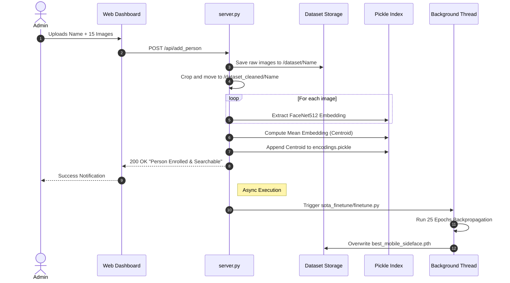
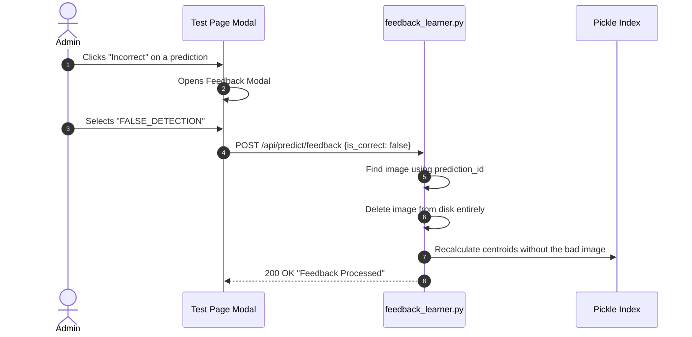

# 10 Data Flow

This document maps out the specific paths data takes through the system for key operations using Mermaid sequence diagrams.

## 1. Face Detection & Inference (Prediction)
When a user approaches a kiosk or a security guard snaps a photo:

## 2. New Person Enrollment
How zero-shot indexing allows for immediate edge deployment.

## 3. The Human-in-the-Loop Feedback Flow
Correcting false positives mathematically purges them from the KNN index.

