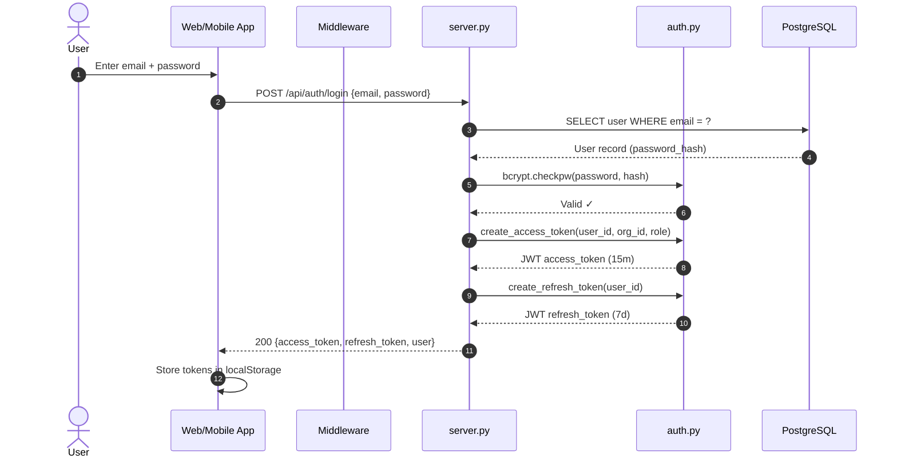
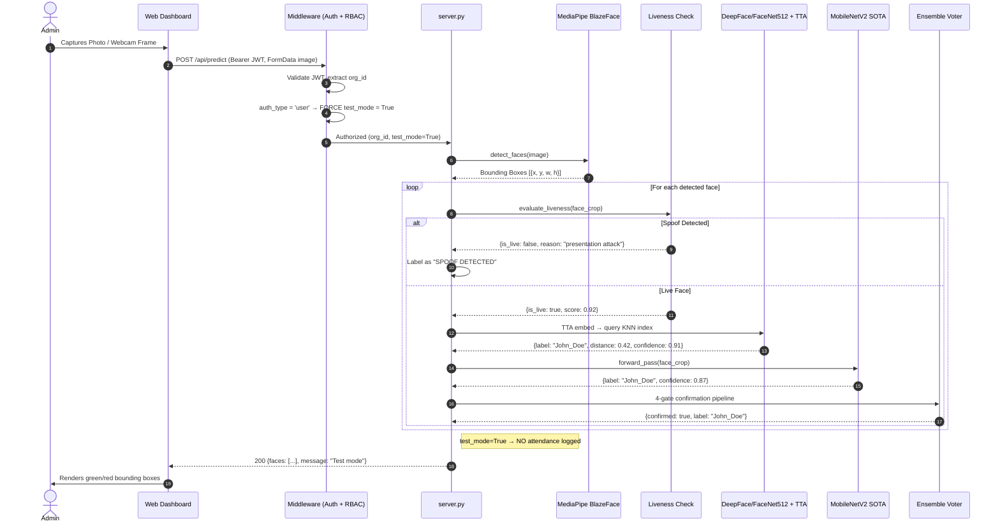
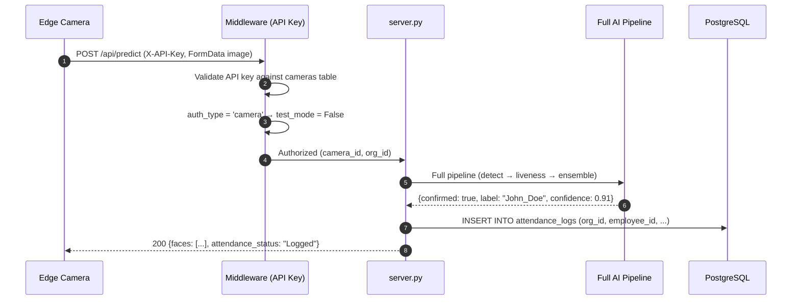
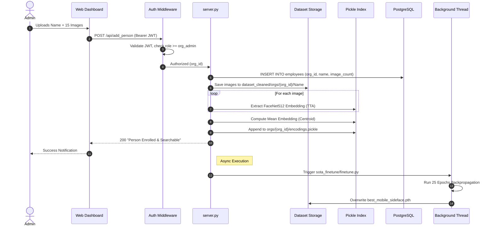
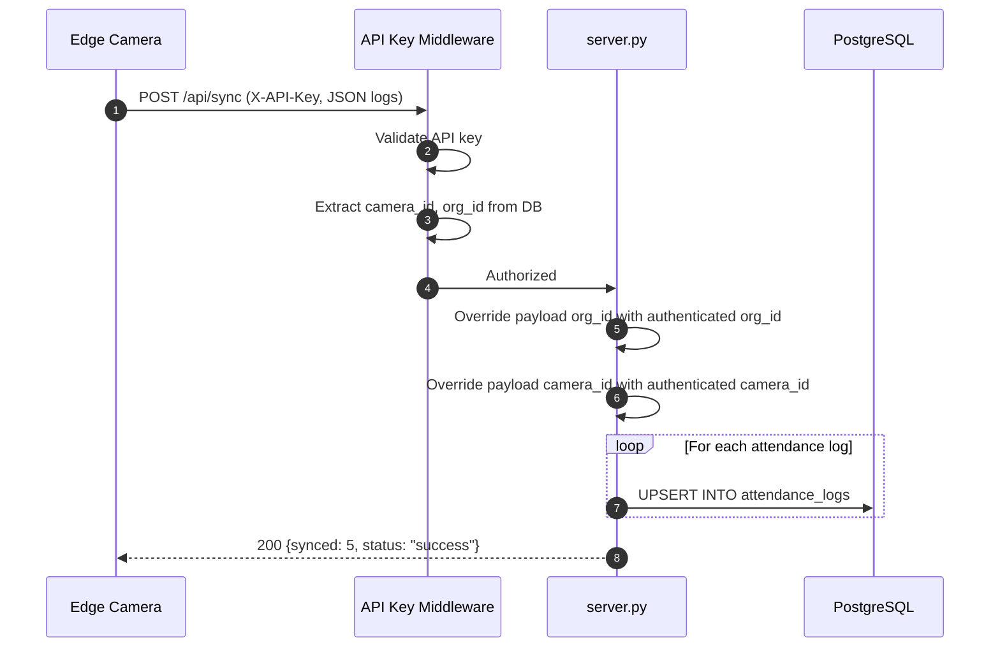
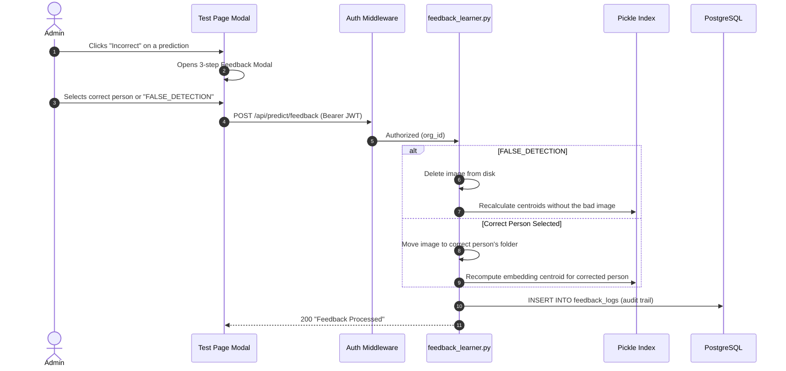

# 10 Data Flow

This document maps out the specific paths data takes through the system for key operations.

## 1. User Authentication (Login)

## 2. Face Detection & Inference (Human User — Test Mode)

When an admin tests the AI from the Web Dashboard:

## 3. Face Detection & Inference (Edge Camera — Production)

When a physical camera detects a face at a gate or kiosk:

## 4. New Person Enrollment

How zero-shot KNN indexing allows for immediate identity recognition:

## 5. Edge-Cloud Attendance Sync

How edge cameras securely push attendance logs to the central database:

## 6. Human-in-the-Loop Feedback

Correcting false predictions and updating the ML index:

