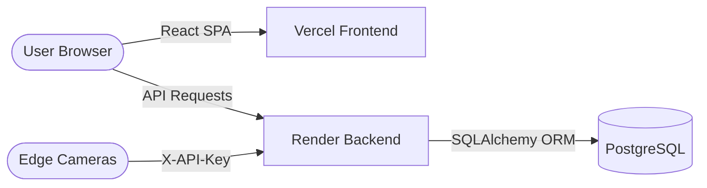

# 12 Deployment

## Deployment Modes
RMS Face AI supports three deployment configurations:

| Mode | Database | Auth | Use Case |
|------|----------|------|----------|
| **Local** (`DEPLOYMENT_MODE=local`) | JSON/Pickle files | Passthrough (no-auth) | Single-tenant edge appliance, demos |
| **Cloud** (`DEPLOYMENT_MODE=cloud`) | PostgreSQL | Full JWT + API Keys | Multi-tenant SaaS production |
| **Hybrid** | PostgreSQL | Full JWT + API Keys | Cloud dashboard + local edge cameras |

---

## Edge Deployment (Local Intranet)
Optimized for data-sovereign deployments where employee biometric data must never leave the local network.

### Hardware Requirements
- **CPU:** Modern multi-core (Intel i5/i7 or AMD Ryzen 5+)
- **RAM:** 8GB minimum (16GB recommended for large enrollments)
- **GPU:** NVIDIA GPU with CUDA support (optional, recommended for >50 employees)
- **Storage:** 10GB+ for model weights and dataset images

### Quick Start (Windows)
```bash
.\start.bat
```
This automatically sets up the Python virtual environment, installs dependencies, and launches both the Flask backend (port 5000) and Vite frontend (port 5173).

### Manual Start
```bash
# Backend
cd backend
python -m venv venv
.\venv\Scripts\activate
pip install -r requirements.txt
python server.py

# Frontend (new terminal)
cd frontend
npm install
npm run dev
```

### Network Configuration
- Allow inbound TCP on Port `5000` (Flask) and `5173` (Vite).
- Mobile devices and edge cameras must be on the same network.
- Configure `LOCAL_CAMERA_KEY` in `.env` for edge camera authentication.

---

## Cloud Deployment (Vercel + Render)
For full SaaS production with multi-tenant support. See [DEPLOY.md](/DEPLOY.md) for detailed step-by-step instructions.

### Architecture


### Frontend → Vercel (Free Tier)
1. Create project at [vercel.com](https://vercel.com).
2. Set **Root Directory:** `frontend`, **Framework:** `Vite`.
3. Add env var: `VITE_API_URL = https://your-backend.onrender.com/api`.
4. Deploy.

### Backend → Render (Free Tier)
1. Create Web Service at [render.com](https://render.com).
2. Set **Start Command:** `cd backend && gunicorn server:app --bind 0.0.0.0:$PORT --timeout 300 --workers 1`
3. Add environment variables:
   - `DEPLOYMENT_MODE=cloud`
   - `DATABASE_URL=postgresql://...`
   - `JWT_SECRET_KEY=<random-64-char-string>`
   - `FRONTEND_URL=https://your-app.vercel.app`
   - `LAZY_LOAD_MODELS=true`
4. Deploy.

### Database → Supabase / Render PostgreSQL
1. Create a free PostgreSQL instance.
2. Copy the connection string to `DATABASE_URL`.
3. Run migrations: `cd backend && alembic upgrade head`.

---

## Docker Deployment
For containerized production deployments.

### Docker Compose
```bash
docker-compose up --build
```
The `docker-compose.yml` orchestrates both frontend and backend containers with proper networking.

### Dockerfile (Backend)
The backend `Dockerfile` extends `python:3.12-slim` with:
- `libgl1-mesa-glx` for OpenCV support.
- `libglib2.0-0` for MediaPipe.
- All pip dependencies from `requirements.txt`.

---

## Database Migrations
When deploying or updating the schema:
```bash
cd backend
alembic upgrade head              # Apply all pending migrations
alembic revision --autogenerate -m "description"  # Generate new migration
alembic downgrade -1              # Rollback one migration
```

---

## Troubleshooting

### Cold Starts (Render Free Tier)
Render's free tier spins down after 15 minutes of inactivity. First request takes ~30-60s to boot. This is expected behavior.

### Gateway Timeouts
Training on free CPU tiers is slow. Keep epochs low (5-10) to avoid timeouts. Gunicorn is configured with `--timeout 300`.

### Memory Limits
Set `LAZY_LOAD_MODELS=true` for free tiers (512MB RAM limit). Models load on first `/api/predict` request instead of at startup.

### CORS Errors
Ensure `FRONTEND_URL` matches your exact Vercel URL (including `https://`). The backend strictly enforces CORS origins in production.

### Storage Volumes (Containers)
Map `/backend/data` and `/dataset_cleaned` to persistent volumes. Container restarts will lose all trained models and embeddings without persistent storage.
