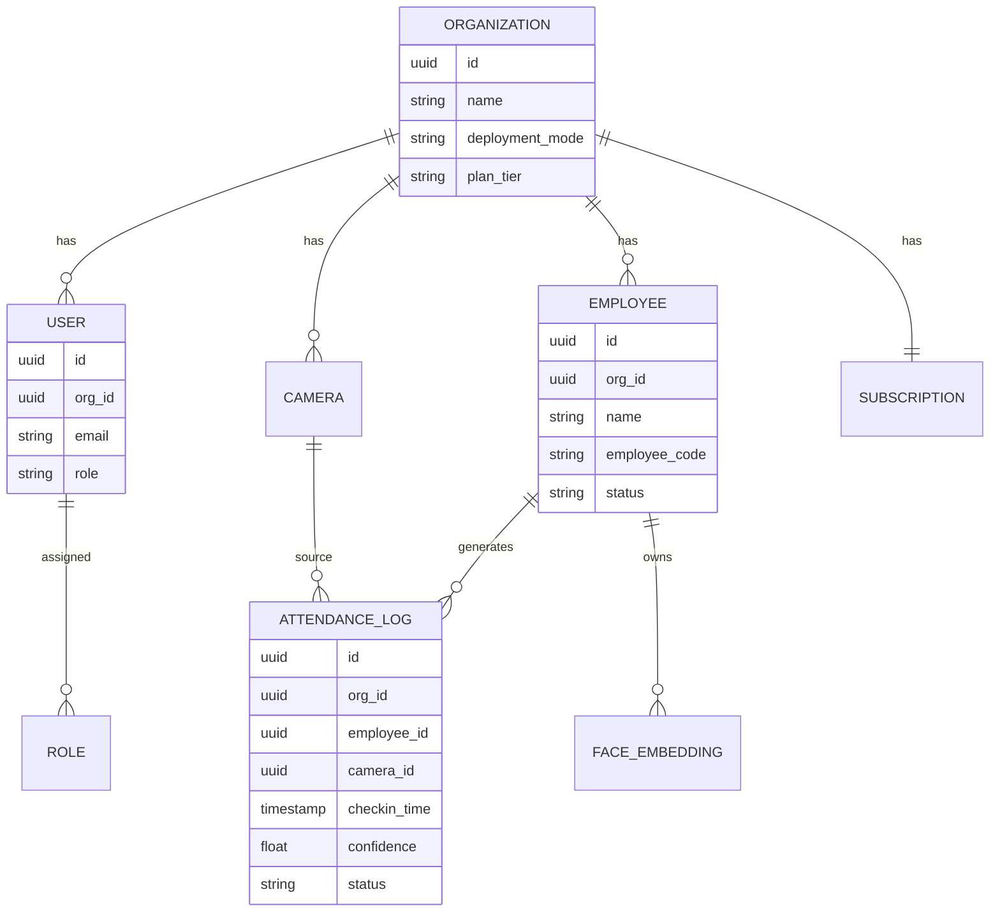

# 16 SaaS Transformation Blueprint

## Purpose of This Document
This is the refined product & architecture plan for turning RMS Face AI from a single-tenant local project into a sellable, multi-tenant SaaS platform. It takes your raw requirements, organizes them, fills the gaps a production system needs, and flags the parts that carry real legal/business risk you should not skip.

Reframed one-line vision: **RMS Face AI becomes a multi-tenant workforce attendance & access-verification platform, deployable per-customer as cloud-hosted or on-prem, billed per active employee, with edge-first face recognition and a continuously improving model via human feedback.**

---

## 1. What "SaaS-Ready" Actually Means Here
Your instinct — "all needed features, support, reliability, accessibility, availability" — breaks down into six concrete engineering pillars. Everything below maps to one of these:

| Pillar | Current State | Gap |
|---|---|---|
| Multi-tenancy | Single global `encodings.pickle` / JSON files | No concept of "organization" at all |
| Access control | None | No RBAC, no auth |
| Billing/metering | None | No plan, no usage tracking |
| Deployment flexibility | Local-only (`start.bat`) + basic Render config | No real cloud multi-tenant mode |
| Reliability | Flask dev server, in-memory models, threading for retrain | Not production-grade |
| Model trust | Ensemble exists, feedback loop exists | Over-detection bug, no versioning, no liveness check |

---

## 2. The Core Architectural Decision You Need to Make First

Your current data layer (`encodings.pickle`, `recognition_history.json`, `config.json`) is a **single global store**. Multi-tenancy cannot be bolted onto flat files safely — one company's employee data would sit in the same file as another's, with isolation enforced only by application code discipline. For a product literally selling itself on "your employees' biometric data stays private," that's not defensible.

**Recommendation:** Introduce PostgreSQL now as the tenant/metadata layer, while *keeping your existing ML core almost untouched*. This is the one place I'd override "don't break existing modules" — the ensemble/inference/detection pipeline stays exactly as designed; only the storage layer around it changes.

- `ensemble.py`, `inference.py`, `face_detection.py` → unchanged in logic. They already accept embeddings + thresholds as inputs; they just need those scoped by `org_id`.
- `encodings.pickle` → replaced by one KNN index **per organization**, either as namespaced pickle files (`data/orgs/{org_id}/encodings.pickle` — fastest to ship) or, once you have real scale, a proper vector store (FAISS/pgvector) keyed by `org_id`. Start with namespaced files; you don't need pgvector at 10 customers.
- `recognition_history.json` → becomes a Postgres `attendance_logs` table (org_id, employee_id, timestamp, confidence, status, camera_id). This was already flagged as a future migration in `08_Database.md` — multi-tenancy is the forcing function that makes it non-optional now.
- `config.json` → becomes a per-org `settings` table (so each customer can tune their own `CONFIRM_THRESHOLD`, per-camera overrides, etc.)

### Data model (new)

Every table carries `org_id`. Every query is scoped by `org_id` at the ORM layer (not just the app layer) — use Postgres Row-Level Security policies as a hard backstop so a bug in application code can't leak one company's data into another's response. This is the single highest-value security investment in this whole plan.

---

## 3. RBAC Design

You asked for org admins managing their own employees with isolation from other orgs. Here's the concrete role matrix:

| Role | Scope | Can Do |
|---|---|---|
| **Platform Owner** (you) | All orgs | Manage billing plans, view platform health, impersonate for support (audited) |
| **Org Admin** | Own org only | Add/remove employees (single + bulk), manage cameras, view all attendance data, manage org users, adjust `CONFIRM_THRESHOLD`, export data |
| **Manager** | Own org, scoped subset (e.g. one department/site) | View attendance for their scope, submit feedback corrections, cannot add/delete employees |
| **Viewer/Auditor** | Own org, read-only | View dashboards and reports only, no writes |
| **Security/Kiosk device identity** | Own org, single camera | Machine identity (API key, not a human login) — only allowed to POST `/predict`, cannot read other employees' data |

Implementation: JWT access token carries `org_id` + `role`. Every protected route wraps with a decorator that checks role *and* injects `org_id` into the query filter automatically — never trust an `org_id` passed in a request body/query param from the client.

---

## 4. Deployment Modes

You asked for cloud vs. local as a toggle — this maps cleanly onto the edge-first architecture you already have:

- **Cloud (multi-tenant hosted):** You run the Postgres + Flask API centrally. Customer's on-site cameras/kiosks still do local capture, but the inference call and the tenant's index live in your cloud infra. Good for customers without IT staff. Latency budget: your `06_AI_Model.md` numbers (300–800ms CPU) still need to work over the customer's internet link, not just LAN — this is a real constraint, budget for it.
- **Local/On-Prem (single-tenant appliance):** Same codebase, `deployment_mode = "local"` in the org record disables the multi-tenant Postgres requirement and falls back to the existing SQLite/local-file mode — effectively today's architecture, just licensed per-org. This is your existing edge design; don't lose it, just gate it behind a license key check.
- **Hybrid (recommended default for enterprise):** Inference stays on-prem (privacy, latency, no cloud GPU bill — this was your original stated goal, keep it), but attendance summaries/analytics sync to a cloud dashboard for cross-site reporting and billing. This is the strongest sales pitch: "your employees' faces never leave your building; only aggregated attendance numbers do."

---

## 5. Employee Onboarding — Single & Bulk

- **Single add:** existing `/api/add_person` flow, scoped to `org_id`, with an added quality gate (below).
- **Bulk add:** new `POST /api/employees/bulk` accepting a CSV (name, employee_code, department, email) + a ZIP of per-employee image folders. Validate row-by-row, return a per-row success/failure report rather than failing the whole batch on one bad entry — this matters a lot at "we're onboarding 200 employees on day one" scale.
- **Quality gate on enrollment (new, addresses your "skewed centroid" edge case from `11_Features.md`):** run a Laplacian-variance blur check and a minimum-face-size check on every enrollment photo before it's accepted into the KNN index. Reject blurry/too-small photos at upload time with a clear error, rather than silently poisoning that employee's centroid.

---

## 6. Fixing the Over-Detection Problem

This is your one concrete bug ("sometimes identifies more faces than actual") and it's worth treating as a first-class fix, not a footnote — it's the kind of thing that erodes a paying customer's trust fastest.

Layered fix, in order of effort:
1. **Cheap, immediate:** raise `minNeighbors` further and add a face-size-relative-to-frame filter (reject boxes under some % of frame area — filters out background clutter that happens to pass Haar's test).
2. **Medium:** add a secondary confirmation pass — run a lightweight landmark detector (MediaPipe Face Mesh) on any Haar-detected box before accepting it. If landmarks (eyes, nose, mouth) can't be found with confidence, discard the box. This catches the classic Haar false positives (clocks, patterned shirts, shadows) that your current `minNeighbors=8` alone doesn't.
3. **Long-term (already on your roadmap in `06_AI_Model.md`/`14_Future_Roadmap.md`):** replace Haar Cascade entirely with RetinaFace or MediaPipe's face detector, which are far more robust across angles and lighting and would also address the >45° yaw limitation you already documented.

Do (1) and (2) before selling this to a second customer. They're cheap and directly fix the trust-damaging bug.

---

## 7. Model Validation & Reinforcement from Feedback

Your feedback loop (`feedback_learner.py`) already exists and is a genuine strength — most competitors don't have this. Formalize it into a real MLOps loop:

1. Every feedback correction is logged with a version tag (which model version was live when the mistake happened).
2. Retraining runs (`sota_finetune.py`) produce a **new versioned model artifact**, not an overwrite of `best_mobile_sideface.pth`. Keep the last N versions.
3. Before promoting a new model version to "live," run it against a held-out validation set and require precision/recall to not regress vs. the previous version. If it regresses, don't auto-promote — flag for review.
4. Track false-positive and false-negative rates per organization over time and surface this as a simple trust metric in the org admin dashboard ("this month: 1,204 confirmed check-ins, 3 corrected"). This turns your feedback engine into a visible product feature, not just internal plumbing.

---

## 8. Security & Legal — Read This Section, Don't Skip It

You flagged "proper security cause company's employees data specifically images was stored" — this is correct instinct and it's bigger than technical access control. Selling biometric tracking of employees to companies puts you inside biometric privacy law in most jurisdictions you'd sell into:

- Many US states (e.g. Illinois' BIPA) require **written consent** before collecting biometric identifiers from employees, plus a published retention/destruction policy.
- The EU GDPR classifies facial biometric data as a "special category," requiring explicit consent and a documented legal basis, with heavy penalties for mishandling.
- India's DPDP Act (relevant since you're Gujarat-based and likely selling locally first) similarly requires consent for processing personal data, with biometric data typically warranting extra care.

This isn't a legal opinion (get a lawyer for actual compliance sign-off), but architecturally you should build for it now rather than retrofit later:
- Store an explicit **consent record** per employee (who consented, when, to what) as a first-class table, not an afterthought.
- Build a **data retention/deletion policy** into the product: org admins should be able to fully purge an employee's images and embeddings, and this deletion should be enforced automatically after a configurable period for terminated employees.
- Add **liveness detection** to your roadmap earlier than "future" — a printed photo defeating a security/attendance system is exactly the kind of failure that kills a sale during a demo. Even a lightweight blink-detection or texture-analysis check is better than nothing.
- Your existing point about embeddings being non-reversible mathematical vectors (`09_Authentication.md`) is a genuinely good privacy argument — keep making it in sales conversations, but don't let it excuse leaving `/dataset_cleaned` raw JPEGs unencrypted at rest.

---

## 9. Production Reliability (the "fast and reliable, prevent errors" ask)

- Replace Flask's dev server with **Gunicorn**, multi-process (not multi-thread, per your own note in `03_Backend.md` about PyTorch/CPU blocking).
- Replace the raw `threading.Thread` retraining trigger with a real job queue (**Celery + Redis**, or RQ if you want something lighter). This gets you retry logic, visibility into stuck jobs, and lets retraining run on separate worker hardware from the inference API in the cloud deployment mode.
- Add **Sentry** for error tracking (already flagged as a recommendation in `12_Deployment.md` — do it now, not later, since debugging a customer's production issue over a support ticket without it is painful).
- Add basic **rate limiting** per org/API-key to prevent one customer's misconfigured camera from hammering the API and degrading service for others.
- **Persistent storage is mandatory in cloud mode** — this was already flagged as a hard requirement in `12_Deployment.md`; it becomes non-negotiable once you have paying customers whose enrolled employees would otherwise vanish on a container restart.

---

## 10. Billing & Plans (per-employee, as you described)

Simple usage-based structure to start:

| Tier | Employees | Cameras | Deployment | Notes |
|---|---|---|---|---|
| Starter | up to 25 | 1 | Local only | Self-serve, low-touch support |
| Business | up to 250 | up to 5 | Cloud or Hybrid | Priority support, analytics dashboard |
| Enterprise | Unlimited | Unlimited | Hybrid/On-Prem | Custom SLA, dedicated support, SSO |

Meter on **active enrolled employees**, not raw predictions — it's the number your customers will intuitively understand and it maps directly to your Org/Employee table, so it's cheap to compute. Stripe (or Razorpay, given you're India-based and it may simplify local payments/GST) handles subscription billing; sync plan limits into the `subscription` table and enforce employee-count caps at the `/api/add_person` and bulk endpoints.

---

## 11. Scope Flag: "Productivity & Efficiency Tracking"

Your closing point about tracking "productivity and efficiency" during working hours is a bigger, separate product (workplace surveillance/analytics) layered on top of attendance tracking. It's a legitimate market, but it's also the area most likely to trigger employee-relations and legal pushback (many places restrict continuous activity monitoring beyond simple in/out logging). Recommend treating this as a **post-MVP, opt-in module** rather than baking it into the core attendance product — ship the trustworthy, narrower attendance/access product first, earn the account, then upsell analytics once you have a customer relationship and clearer legal footing per-region.

---

## 12. Using Your Antigravity Agent Fleet Effectively

Since you have unmetered access across Gemini 3.5 Flash (Low/Medium/High) and 3.1 Pro (Low/High), assign by task risk, not just speed:

- **Gemini 3.1 Pro (High):** the multi-tenancy data model, RLS policies, RBAC middleware, auth/JWT logic, billing integration, and any change to `ensemble.py`'s threshold logic. This is the code where a subtle bug leaks another company's data or lets someone bypass access control — use your strongest reasoning tier here, and always review it yourself before merging (per your own review authority).
- **Gemini 3.1 Pro (Low):** database migration scripts, retrain-pipeline versioning logic — needs correctness but lower blast radius than auth code.
- **Gemini 3.5 Flash (High):** repetitive CRUD endpoints (employees, cameras, orgs), bulk-upload validation logic, dashboard pages, mobile screen parity work.
- **Gemini 3.5 Flash (Medium/Low):** UI polish, copy, test scaffolding, boilerplate React components, CSS variable cleanup.

Keep your existing domain-divided strategy (Claude for UI/design system, Gemini for backend/API) — just add the Pro/Flash split above as a second axis within the Gemini side: **Pro for anything touching data isolation or money, Flash for everything else.**

---

## 13. Phased Roadmap

**Phase 1 — Multi-tenant foundation (do this before anything else)**
Postgres + `org_id` everywhere, RBAC + JWT auth, namespaced per-org encodings, consent records, deletion policy.

**Phase 2 — Fix trust issues**
Over-detection fix (layered approach above), model versioning, feedback-loop metrics dashboard.

**Phase 3 — SaaS operations**
Billing/plan enforcement, bulk employee onboarding, Gunicorn + job queue, Sentry, rate limiting.

**Phase 4 — Deployment flexibility**
Cloud/local/hybrid toggle, on-prem license gating, cross-site cloud dashboard sync.

**Phase 5 — Differentiation**
Liveness detection, RetinaFace/MediaPipe migration, per-camera threshold tuning, opt-in analytics module.

Each phase is shippable and sellable on its own — you don't need Phase 5 to close your first paying customer; you need Phase 1 and Phase 2 solid.
