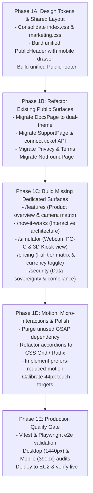

# AuraPass™ Enterprise — Public Experience Redesign Roadmap (Phase 1 & Beyond)
**Authority**: Principal Product Designer & Senior Frontend Architect  
**Objective**: Transform AuraPass into an authoritative, calm, high-conversion SaaS platform adhering to Emil Kowalski motion engineering and Apple HIG design standards.  
**Date**: November 5, 2026

---

## 1. Architectural Principles for the Redesign

1. **Strict Theme Sovereignty**: Every public page must default to a pristine light mode (Cal.com / Pop.site slate-50 aesthetic) while supporting a dark mode (neutral zinc obsidian) with zero hardcoded hex colors.
2. **Component Reuse & Single Source of Truth**: Replace the 5 divergent headers with one authoritative `PublicHeader` component featuring responsive mobile navigation.
3. **No Decorative Slop or Fake Features**: Eliminate mock SSO buttons, static "simulation" cards, and fictional persona recycling. Every interactive element must either connect to real runtime capabilities or provide transparent enterprise information.
4. **Motion Discipline**: Enforce Emil Kowalski's rules—animate composite properties only (`transform`, `opacity`), eliminate `transition-all`, replace custom Framer Motion height animations with CSS Grid / Radix primitives, and support `prefers-reduced-motion`.

---

## 2. Phased Implementation Roadmap

---

## 3. Detailed Work Breakdown

### Phase 1A: Design Tokens & Shared Layout (Foundation)
- **Task 1A.1**: Unify `frontend/src/index.css` and `frontend/src/styles/marketing.css`.
  - Establish a single set of semantic Tailwind CSS variables: `--background`, `--foreground`, `--card`, `--border`, `--primary`, `--muted`.
  - Harmonize dark mode palette to pure neutral zinc (`#09090B`, `#18181B`, `#27272A`) matching the console pages.
- **Task 1A.2**: Build `frontend/src/components/layout/PublicHeader.jsx`.
  - Canonical logo mark: `<Shield>` with emerald glow.
  - Links: `Features`, `How It Works`, `Pricing`, `Docs`, `Support`.
  - Responsive mobile drawer (`<Menu>` toggle, slide-over navigation with backdrop blur).
  - Synced theme toggle (`<Sun>` / `<Moon>`) with system preference detection.
  - Contextual CTA: "Open Console" if authenticated, "Start Free" if guest.
- **Task 1A.3**: Build `frontend/src/components/layout/PublicFooter.jsx`.
  - Structured columns: Product, Developers & IT, Compliance & Legal, Company.
  - Live system status indicator: `All Systems Operational • On-Premise Engine v2026.2`.

---

### Phase 1B: Refactor Existing Public Surfaces (Theme & UX Alignment)
- **Task 1B.1**: Upgrade `DocsPage.jsx`:
  - Replace hardcoded `bg-[#06090B]` with `bg-background text-foreground`.
  - Integrate unified `PublicHeader` and `PublicFooter`.
  - Lower the Table of Contents rail breakpoint from `xl` (`1280px`) to `lg` (`1024px`).
  - Add dedicated documentation article: *"Employee Privacy & Biometric Data Sovereignty"*.
- **Task 1B.2**: Upgrade `SupportPage.jsx`:
  - Convert to semantic design tokens (supporting Light and Dark modes).
  - Connect ticket form to backend endpoint (`POST /api/support/ticket` or persistent audit log).
  - Add search filter across technical runbooks.
- **Task 1B.3**: Upgrade `PrivacyPolicyPage.jsx` & `TermsPage.jsx`:
  - Convert to semantic design tokens.
  - Optimize mobile layout: hide print button on screens $< 640\text{px}$, improve typography line-heights.
- **Task 1B.4**: Upgrade `NotFoundPage.jsx`:
  - Remove `Press ⌘K` on mobile devices; provide intuitive quick-navigation buttons.

---

### Phase 1C: Build Missing Dedicated Public Pages (SaaS Completeness)
- **Task 1C.1**: Create `/features` (`frontend/src/pages/FeaturesPage.jsx`):
  - Hardware compatibility matrix (Hikvision, Dahua, Axis, CP Plus, USB UVC, iPads).
  - Real-time inference benchmarks (0.18s FaceNet512, 15ms BlazeFace).
  - Rostering engine specifications (custom shifts, 15m grace allowances, overtime rules).
- **Task 1C.2**: Create `/how-it-works` (`frontend/src/pages/HowItWorksPage.jsx`):
  - Interactive 5-step visual pipeline: RTSP Frame Capture $\rightarrow$ BlazeFace Face Alignment $\rightarrow$ 512-D Embedding $\rightarrow$ Cosine Matching $\rightarrow$ 24V Turnstile Relay.
- **Task 1C.3**: Create `/simulator` (`frontend/src/pages/SimulatorPage.jsx`):
  - Live client-side camera test: allows prospective users to test facial detection and liveness on their own webcam in under 10 seconds without logging in.
  - 3D Interactive Virtual Turnstile Kiosk view illustrating physical gate unlatching.
- **Task 1C.4**: Create `/pricing` (`frontend/src/pages/PricingPage.jsx`):
  - Full comparison table across Starter, Business Pro, and Enterprise tiers.
  - Monthly vs Annual billing toggle (with 20% annual discount incentive).
  - Currency toggle (INR `₹` for India, USD `$` for international enterprise).
- **Task 1C.5**: Create `/security` (`frontend/src/pages/SecurityTrustPage.jsx`):
  - In-depth compliance breakdown: DPDP Act 2023, GDPR Article 9, ISO/IEC 30107 liveness.
  - Cryptographic non-inversion explanation and air-gapped Docker deployment guides.

---

### Phase 1D: Motion & Performance Polish (Emil Kowalski Standards)
- **Task 1D.1**: Purge `gsap` from `package.json` and prune unused imports.
- **Task 1D.2**: Eliminate `transition-all` across all components; specify exact compositor-safe properties (`transition-transform`, `transition-opacity`, `transition-colors`).
- **Task 1D.3**: Replace Framer Motion `height: auto` accordion with Radix UI Accordion or CSS Grid `grid-template-rows`.
- **Task 1D.4**: Implement `@media (prefers-reduced-motion: reduce)` hooks (`useReducedMotion()`).
- **Task 1D.5**: Audit and enforce 44×44pt touch targets on all mobile controls.

---

### Phase 1E: Quality Gate Verification & Deployment
- **Task 1E.1**: Execute automated frontend build (`npm run build`).
- **Task 1E.2**: Run automated browser testing suite (Playwright MCP) verifying:
  - 1440px desktop rendering across all routes.
  - 390px mobile viewport rendering across all routes.
  - WCAG 2.1 AA color contrast compliance ($\ge 4.5:1$).
- **Task 1E.3**: Package and deploy updated frontend build to production EC2 (`https://13-60-225-165.sslip.io`).
- **Task 1E.4**: Commit and push changes to GitHub repository.

---

## 4. Priority Implementation Matrix

| Phase | Milestone | Primary Deliverable | Risk / Dependencies | Complexity |
| :--- | :--- | :--- | :--- | :--- |
| **1A** | Design System Harmonization | `PublicHeader`, `PublicFooter`, `index.css` token sync | Low risk; preserves backend contracts. | **Medium** |
| **1B** | Existing Public Surface Upgrade | Dual-theme Docs, Support, Legal & 404 pages | Zero backend risk; high UX impact. | **Medium** |
| **1C** | Missing SaaS Surfaces | `/features`, `/how-it-works`, `/pricing`, `/security`, `/simulator` | Routing additions in `App.jsx`. | **Large** |
| **1D** | Motion & Ergonomics Polish | Radix accordion, reduced-motion, GSAP removal | Improves mobile FPS and accessibility. | **Small** |
| **1E** | Verification & Deployment | Playwright automated visual regression & EC2 reload | Production release gate. | **Small** |

