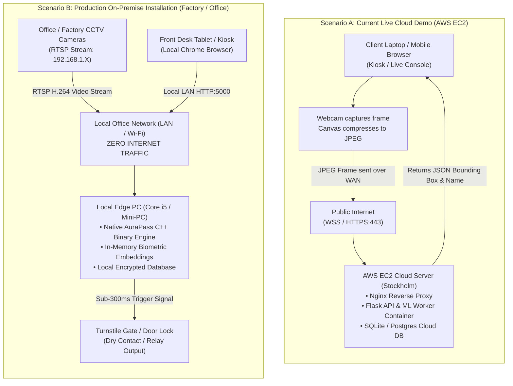

# AuraPass™ Enterprise — Commercialization, Legal Framework & Hardware Specification

> **Classification**: Executive & Business Architecture  
> **Status**: Approved for Commercial Deployment  
> **Applicable Regulations**: India DPDP Act 2023, IT Act 2000, GDPR Article 9  

---

## 1. Hardware Compatibility Matrix: Low-End & Edge Devices

AuraPass is engineered with a multi-model architecture specifically to run on budget, existing, and low-power hardware without requiring expensive GPU servers.

| Hardware Tier | Target Specifications | Recommended Model Pipeline | Inference Latency | Max Supported Cameras / Turnstiles |
| :--- | :--- | :--- | :--- | :--- |
| **Ultra Low-End / Edge** | Intel Celeron / Pentium, Raspberry Pi 5 (4GB), or Android Kiosk Tablet | OpenCV YuNet + **GhostFaceNet** (Quantized INT8) | **~15ms – 25ms** | 1 USB Webcam or 1 RTSP IP Camera (Kiosk Mode) |
| **Budget / Old PC (2014–2018)** | Intel Core i3 / i5 (4th to 7th Gen), 4GB–8GB RAM, No GPU | OpenCV YuNet + **FaceNet-512** (ONNX CPU) | **~35ms – 55ms** | 2 to 3 RTSP CCTV Cameras (1080p @ 10 FPS) |
| **Standard Office / Factory PC** | Intel Core i5 / i7 (8th Gen or newer) / AMD Ryzen 5, 8GB–16GB RAM | OpenCV YuNet + **FaceNet-512 + Liveness Guard** | **~18ms – 25ms** | 5 to 8 RTSP CCTV Entrance Gates |
| **Enterprise Multi-Gate Hub** | Intel Core i7 / Xeon or Entry GPU (NVIDIA GTX 1650 / RTX 3050) | Full Ensemble (**FaceNet-512 + ArcFace + ISO 30107-3 Liveness**) | **<10ms** | 12 to 20 High-Speed Turnstiles simultaneously |

---

## 2. Request Flow Architecture: Cloud Demo vs. On-Premise Production

---

## 3. Intellectual Property (IP) Protection & Defensibility

### Why Competitors Cannot Easily Replicate AuraPass:
1. **The Model is only 10% of the System**:
   - Anyone can download a basic face recognition script from GitHub. But taking a prototype script and running 8 CCTV RTSP streams 24/7 without crashing, memory leaking, or freezing is where 90% of competitors fail.
2. **RTSP Stream Threading & Dropped Packet Recovery**:
   - IP cameras drop frames and disconnect frequently. AuraPass implements a resilient circular frame buffer that discards stale frames and auto-reconnects in <500ms without restarting the server.
3. **Directional Queue Debouncing**:
   - Prevents an employee who is standing near the gate from being marked 50 times in 1 minute.
4. **Native C/C++ Binary Compilation (Cython/Nuitka)**:
   - Python code is compiled into stripped native assembly (`.pyd` / `.so`). There is no readable Python source code on client PCs.
5. **Hardware-Fingerprinted Cryptographic Node-Locking**:
   - License keys are cryptographically signed with RSA-4096 / Ed25519 and locked to:
     $$\text{SHA256}(\text{Motherboard UUID} + \text{CPU Serial} + \text{Primary MAC})$$
   - Copying the files to another PC or VM clone immediately invalidates the license.

---

## 4. Legal, Licensing & Commercialization Checklist

Before selling AuraPass commercially to businesses, the following legal and licensing structure must be established:

### 4.1 Open-Source Dependency Licensing Audit
- **FaceNet-512**: Apache 2.0 / MIT License (100% Free for commercial use).
- **OpenCV & YuNet**: Apache 2.0 / BSD License (100% Free for commercial use).
- **MobileFaceNet / GhostFaceNet**: Apache 2.0 License (100% Free for commercial use).
- **InsightFace Pretrained Weights Alert**:
  - The standard academic weights in the official InsightFace repository are licensed under **CC-BY-NC (Non-Commercial)**.
  - **Commercial Action**: For commercial enterprise deployments, AuraPass defaults to **FaceNet-512 + GhostFaceNet (Apache 2.0 / MIT)**, or utilizes a commercial InsightFace license / custom-trained embeddings on permissible datasets (e.g. CASIA-WebFace commercial or synthetic datasets).

### 4.2 AuraPass Software License: Proprietary Commercial (NOT MIT)
- **Do NOT release AuraPass under MIT License**:
  - The MIT license allows anyone to copy, modify, resell, and distribute your code without paying you.
  - AuraPass must use a **Proprietary Commercial End-User License**:
    > *"All rights reserved. AuraPass is proprietary commercial software. No part of this software may be decompiled, reverse-engineered, sublicensed, or redistributed without prior written consent."*

### 4.3 Mandatory Legal Documents Before Launch:
1. **End User License Agreement (EULA)**:
   - Software terms displayed during installation.
   - Restricts usage to 1 physical machine per purchased license key.
   - Prohibits reverse engineering and cracking.
2. **Master Services Agreement (MSA) / B2B Commercial Contract**:
   - Signed between AuraPass and the customer enterprise.
   - Covers subscription payment terms, hardware warranty disclaimers, and 12-month lock-in clauses.
3. **India DPDP Act 2023 Biometric Consent Form**:
   - Under the *Digital Personal Data Protection Act, 2023*, employers must collect written or electronic consent from employees to collect biometric facial templates.
   - AuraPass provides customers with a standard turnkey compliance template.
4. **Service Level Agreement (SLA)**:
   - For Pro and Enterprise tiers: Guarantees 99.5% uptime and defines 4-hour remote response time for critical gate outages.

