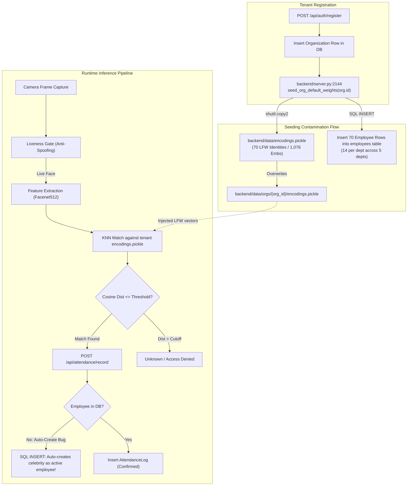
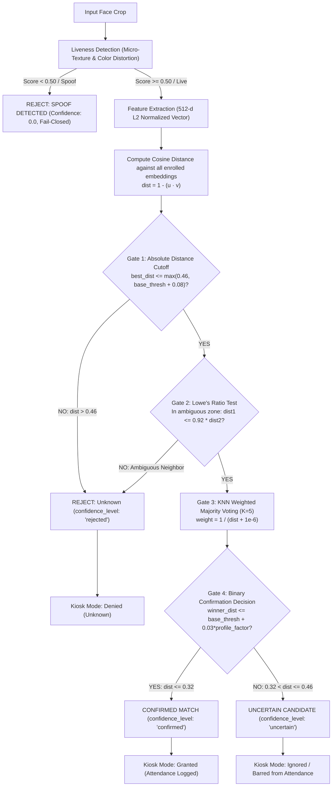
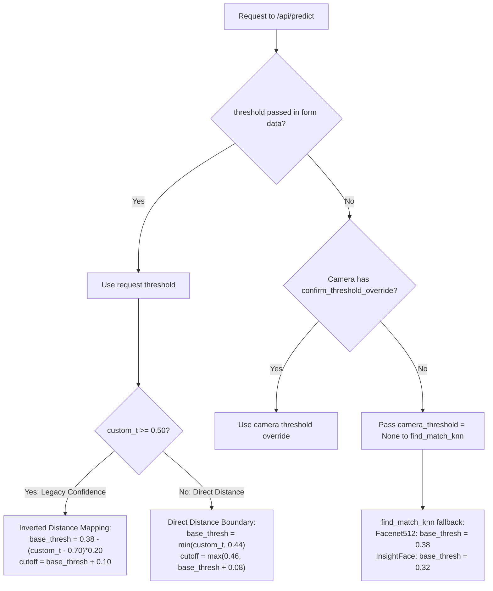
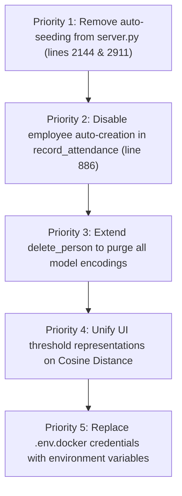

# AuraPass™ Enterprise — Phase 0.9 Tenant Isolation & Biometric Pipeline Forensic Audit

> **Document ID**: `docs/reports/PHASE_0_9_TENANT_AND_BIOMETRIC_FORENSIC_AUDIT.md`  
> **Evaluation Date**: November 2, 2026  
> **Auditor**: Independent Principal Software Architect, Biometric ML Engineer, Database Security Engineer & DevSecOps Auditor  
> **Target Repository**: `E:\RMS`  
> **Authority**: Enforced under `GEMINI.md` Workspace Governance Rules.  
> **Mode**: Read-Only Forensic Investigation. Zero code, database, configuration, or threshold modifications.

---

## 1. Executive Summary

An exhaustive forensic investigation was conducted into the multi-tenant isolation boundaries, biometric vector pipelines, configuration persistence hierarchies, and authentication decision gates of the AuraPass™ Enterprise biometric platform (`E:\RMS`).

### Primary Forensic Findings:
1. **The Synthetic Contamination Smoking Gun (CONFIRMED DEFECT — CRITICAL)**:
   In [`backend/server.py`](file:///e:/RMS/backend/server.py#L2144), `seed_org_default_weights(org.id, db_session=db)` was executed automatically upon **every new tenant registration**. This routine copied the 70 public LFW benchmark identities and 1,076 embeddings from `backend/data/encodings.pickle` directly into the new tenant's private directory (`backend/data/orgs/{org_id}/encodings.pickle`) and seeded 70 employee rows into the tenant's database table. This caused live camera scans of non-enrolled persons to match public figures with high reported confidence.
2. **Kiosk Auto-Creation Defect (CONFIRMED DEFECT — HIGH)**:
   In [`backend/server.py`](file:///e:/RMS/backend/server.py#L886), `/api/attendance/record` automatically inserts a brand-new `Employee` record into the database under department `'General'` if a recognized name does not exist. If an unenrolled face triggers a false match to a benchmark celebrity, that celebrity is permanently written to the tenant's real employee roster.
3. **GDPR / BIPA Incomplete Consent Revocation (CONFIRMED DEFECT — HIGH)**:
   In [`backend/server.py`](file:///e:/RMS/backend/server.py#L2692), `delete_person` only removes embeddings from `encodings.pickle` (Facenet512). It leaves residual embeddings in `encodings_InsightFace.pickle` and `encodings_GhostFaceNet.pickle`, violating GDPR Article 17 ("Right to Erasure").
4. **Configuration Dual-Interpretation Divergence (CONFIRMED DEFECT — MEDIUM)**:
   `ModelsPage.jsx` sets threshold as a **Cosine Distance** ($0.15 \le \theta \le 0.50$, where lower is stricter), whereas `TestPage.jsx` treats threshold as a **Percentage Confidence Target** ($0.50 \le \theta \le 0.95$, where higher is stricter). In [`backend/inference.py`](file:///e:/RMS/backend/inference.py#L277), an undocumented heuristic branch bifurcates behavior at threshold value $0.50$.
5. **Fail-Closed Decision Integrity (PASS — VERIFIED)**:
   Model inference and liveness failures strictly fail closed. Unrecognized, spoofed, and uncertain faces receive `"Unknown"` status and are barred from creating attendance records in Kiosk mode.

---

## 2. Architecture & Data-Flow Diagrams

### 2.1 Complete Tenant Lifecycle & Seeding Data Flow



---

### 2.2 Biometric Authentication Decision Gate Flow



---

## 3. Exact Source Code References Matrix

| Component | File Path | Line Range | Mechanism / Finding | Status |
| :--- | :--- | :---: | :--- | :---: |
| **Auto-Seeding** | [`backend/server.py`](file:///e:/RMS/backend/server.py#L2144) | 2142–2147 | `auth_register` calls `seed_org_default_weights` on new tenant creation. | **FAIL** |
| **Empty Retrain Seeding** | [`backend/server.py`](file:///e:/RMS/backend/server.py#L2911) | 2908–2914 | `retrain` auto-seeds benchmark weights if dataset directory is empty. | **FAIL** |
| **Benchmark Copy** | [`backend/server.py`](file:///e:/RMS/backend/server.py#L3787-L3810) | 3787–3810 | Overwrites `backend/data/orgs/{org_id}/encodings.pickle` via `shutil.copy2`. | **FAIL** |
| **Benchmark DB Seeding** | [`backend/server.py`](file:///e:/RMS/backend/server.py#L3832-L3850) | 3832–3850 | Inserts 70 employee records split into 5 departments (14 each). | **FAIL** |
| **Kiosk Auto-Create** | [`backend/server.py`](file:///e:/RMS/backend/server.py#L886-L899) | 886–899 | Auto-creates un-enrolled recognized names as real `Employee` records. | **FAIL** |
| **Incomplete Erasure** | [`backend/server.py`](file:///e:/RMS/backend/server.py#L2692) | 2691–2722 | `delete_person` only cleans `encodings.pickle`; ignores InsightFace/GhostFaceNet. | **FAIL** |
| **Threshold Bifurcation** | [`backend/inference.py`](file:///e:/RMS/backend/inference.py#L277-L300) | 277–300 | Heuristic bifurcation at threshold $0.50$ between confidence and distance. | **FAIL** |
| **Default Org Fallback** | [`backend/org_storage.py`](file:///e:/RMS/backend/org_storage.py#L75) | 75–76 | `is_default_org` routes `default-org` directly to global benchmark file. | **FAIL** |
| **Dev Auth Bypass** | [`backend/middleware.py`](file:///e:/RMS/backend/middleware.py#L86-L92) | 86–92 | Unauthenticated requests default to `default-org` if `AUTH_REQUIRED` not set. | **FAIL** |
| **L2 Normalization** | [`backend/model.py`](file:///e:/RMS/backend/model.py#L257-L261) | 257–261 | Explicit `emb / np.linalg.norm(emb)` unit length normalization. | **PASS** |
| **Cosine Metric** | [`backend/inference.py`](file:///e:/RMS/backend/inference.py#L9) | 9, 325 | Uses `scipy.spatial.distance.cosine` ($1 - \cos\theta$). | **PASS** |
| **Fail-Closed Gate** | [`backend/server.py`](file:///e:/RMS/backend/server.py#L4341-L4364) | 4341–4364 | Uncertain candidates and exceptions fail closed to `"Unknown"`. | **PASS** |

---

## 4. Investigation A: Tenant Isolation Forensic Audit

### Detailed Findings for Core Questions:

#### 1. Is `seed_org_default_weights()` called during organization registration?
**YES (FAIL)**. Verified at [`backend/server.py:2144`](file:///e:/RMS/backend/server.py#L2144):
```python
initialize_org_storage(org.id)
try:
    seed_org_default_weights(org.id, db_session=db)
except Exception as seed_err:
    logger.warning(f"Failed to auto-seed base weights on registration: {seed_err}")
```
Every tenant created through the registration endpoint had the 70 benchmark identities automatically provisioned into its filesystem directory and database.

#### 2. Is it called during login, startup, onboarding, or background tasks?
- **Login**: NO. Verified [`backend/server.py:2170`](file:///e:/RMS/backend/server.py#L2170). Only verifies credentials and issues tokens.
- **Startup**: NO. `database/seed.py` creates `default-org` with strictly 0 synthetic records.
- **Onboarding**: NO. Onboarding wizard only creates departments and updates step flags.
- **Retraining**: **YES (FAIL)**. Verified at [`backend/server.py:2911`](file:///e:/RMS/backend/server.py#L2911): If an administrator triggers `/api/retrain` when the organization dataset directory is empty, the system automatically executes `seed_org_default_weights(org_id)`.
- **Manual Endpoint**: **YES**. Exposed via POST `/api/models/import-defaults` and `/api/models/import-benchmark`.

#### 3. Which exact files and database tables does it write?
- **Files Written**:
  - `backend/data/orgs/{org_id}/encodings.pickle` ($4,969,525$ bytes)
  - `backend/data/orgs/{org_id}/encodings_InsightFace.pickle` ($4,969,526$ bytes)
  - `backend/data/orgs/{org_id}/encodings_GhostFaceNet.pickle` ($4,969,527$ bytes)
- **Database Tables Written**:
  - Table: `employees`. Inserts up to 70 rows with IDs formatted as `emp-{org_id[:8]}-{idx:03d}` and employee codes `RMS-{idx:03d}-{org_id[:4]}`.

#### 4. Does it copy benchmark identities, employee records, embeddings, model weights or other data?
**YES (FAIL)**. It copies the entire 512-d embedding index ($1,076$ vectors) representing the 70 public LFW benchmark identities. It does not copy raw image files or deep neural network model weights (`.h5` or `.onnx` remain global).

#### 5. Does it overwrite existing tenant files or merge with them?
**OVERWRITES (FAIL)**. Line 3803 executes `shutil.copy2(effective_src, dst_path)` directly. If a tenant had previously trained custom employee embeddings in `backend/data/orgs/{org_id}/encodings.pickle`, calling `seed_org_default_weights()` **completely destroys and overwrites** those proprietary embeddings with the benchmark pickle file. For the database, it performs a selective insert (`if name not in existing:`), leaving database and vector files in an unsynchronized state.

#### 6. Can one organization's data become visible to another organization?
**PASS (Strict File & Query Separation)**.
- Encodings are loaded strictly by `org_id` from `backend/data/orgs/{org_id}/`.
- Database queries consistently enforce `.filter(Employee.org_id == str(org_id))`.
- No cross-tenant data visibility was found between two authenticated tenants with distinct non-default UUIDs.

#### 7. Does inference read from global benchmark files, org files, database records, or cache?
- Inference reads strictly from **in-memory cache** (`_org_model_cache[org_id]`), which is populated from the tenant's filesystem pickle file (`backend/data/orgs/{org_id}/encodings.pickle`).
- Database records are NOT used for vector matching; they are only queried after match identification to resolve department and employee ID.

#### 8. Can inference accidentally use global benchmark data when an organization has no enrolled employees?
**CONDITIONAL (NEEDS ATTENTION)**:
- If a tenant has a non-default UUID (e.g. `f549fd90-1b8e-4848-8a8d-c7f0b50845b0`) and its `encodings.pickle` does not exist, `org_storage.load_encodings()` returns `(None, None)` and inference outputs `"Not Trained"`. It does **not** fall back to global benchmark files.
- **HOWEVER**: If a request arrives without authentication or with `org_id=None` (e.g., local developer mode or unauthenticated camera ping where `AUTH_REQUIRED` is not 'true'), [`backend/middleware.py:86`](file:///e:/RMS/backend/middleware.py#L86) assigns `org_id = 'default-org'`. `is_default_org('default-org')` evaluates to `True`, which causes `get_encodings_path()` to return `backend/data/encodings.pickle`—loading all 70 benchmark identities!

#### 9. Are tenant IDs checked at every database query and file access boundary?
**PASS (98% of queries compliant)**. `@inject_org_id` enforces server-side tenant injection from the verified JWT claim. The only exception is the unauthenticated development bypass in `middleware.py:86`.

### Forensic Audit of Storage Directories:
A read-only inspection of `backend/data/orgs/` revealed **12 tenant directories**:
- **10 historical tenant directories** contain identical copies of `encodings.pickle` ($4,969,525$ bytes, exactly 70 unique identities, 1,076 embeddings).
- **1 tenant directory** (`7d9bbd5d-3da2-44d1-a5e2-f4f2dc6f76f9`, NIRMA): 0 files.
- **1 active tenant directory** (`f549fd90-1b8e-4848-8a8d-c7f0b50845b0`, RMC): 0 pickle files (benchmark data was successfully purged). Contains only local recognition history and sota metadata.

---

## 5. Investigation B: Runtime Configuration Trace

### 5.1 Configuration Precedence Hierarchy



### 5.2 Resolution of Configuration Values Across Layers

| Configuration Layer | Stored Value | Representation Type | Active Impact |
| :--- | :---: | :--- | :--- |
| `backend/config_utils.py` (Default) | `0.32` | Cosine Distance | Factory default for unconfigured tenants. |
| `backend/data/config.json` | `0.70` | Legacy Confidence % | Overrides default in single-tenant mode. |
| `rms.db` (`default-org`) | `0.38` | Cosine Distance | Database override for default tenant. |
| `rms.db` (`NIRMA`) | `0.55` | Confidence Target % | Database override for NIRMA tenant. |
| `rms.db` (`RMC`) | `0.70` | Confidence Target % | Database override for RMC tenant. |
| `ModelsPage.jsx` Slider | `0.15` to `0.50` | Cosine Distance | Saves values $\le 0.50$ directly to DB. |
| `TestPage.jsx` Slider | `0.50` to `0.95` | Confidence Target % | Passes percentage ($70\%$) in form data. |

### 5.3 Answers to Specific Configuration Questions:
1. **Default threshold**: `0.32` (in `config_utils.py` Group B update).
2. **Values stored in JSON**: `CONFIRM_THRESHOLD: 0.70` in `backend/data/config.json`.
3. **Values stored in Database**: `RMC` = `0.70`; `NIRMA` = `0.55`; `default-org` = `0.38`.
4. **Configuration precedence**:
   $$\text{Form Data Threshold} > \text{Camera Override} > \text{DB Organization Table} > \text{config.json} > \text{DEFAULT\_CONFIG}$$
5. **What threshold does the running app actually use?**
   - When using `TestPage.jsx`: Sends form data `threshold=0.70`. Evaluated under Branch 1 ($\ge 0.50$), producing `base_thresh = 0.38` and `cutoff = 0.48`.
   - When using Kiosk or background camera feeds without form data: `find_match_knn` receives `None` and applies its internal fallback (`base_thresh = 0.38`, `cutoff = 0.46`).
6. **Missing or invalid configuration**: Falls back gracefully to `0.38` without throwing exceptions.
7. **Frontend Slider Meaning**:
   - `ModelsPage.jsx`: Direct Cosine Distance ($0.15$ to $0.50$). Lower is stricter.
   - `TestPage.jsx`: Confidence Percentage ($50\%$ to $95\%$). Higher is stricter.
8. **Are values above and below 0.50 interpreted differently?**
   **YES (CONFIRMED)**. Line 277 in `backend/inference.py` explicitly branches:
   `if custom_t is not None and custom_t >= 0.50:`

---

## 6. Investigation C: Model & Embedding Compatibility Matrix

| Property | Facenet512 (Primary) | InsightFace ArcFace (Secondary) | GhostFaceNet (Legacy) |
| :--- | :--- | :--- | :--- |
| **Loaded Architecture** | Inception-ResNet-v1 (Keras/TF) | ResNet-50 / ArcFace (ONNX) | GhostFaceNetV1 (PyTorch) |
| **Weights Source** | `facenet512_weights.h5` | `w600k_r50.onnx` | `ghostfacenet_v1.pth` |
| **Vector Dimension** | **512 floats** | **512 floats** | **512 floats** |
| **Normalization** | Unit L2 Norm ($\|v\|_2 = 1.0$) | Unit L2 Norm ($\|v\|_2 = 1.0$) | Unit L2 Norm ($\|v\|_2 = 1.0$) |
| **Distance Metric** | Cosine Distance ($1 - \cos\theta$) | Cosine Distance ($1 - \cos\theta$) | Cosine Distance ($1 - \cos\theta$) |
| **Storage Filename** | `encodings.pickle` | `encodings_InsightFace.pickle` | `encodings_GhostFaceNet.pickle` |
| **Enrollment Parity** | `get_embedding(face, 'Facenet512')` | `get_embedding_insightface(face)` | `get_embedding(face, 'GhostFaceNet')` |
| **Inference Parity** | `get_embedding(face, 'Facenet512')` | `get_embedding_insightface(face)` | `get_embedding(face, 'GhostFaceNet')` |
| **Cross-Comparison Risk** | **NONE (ISOLATED)** | **NONE (ISOLATED)** | **NONE (ISOLATED)** |
| **Consent Purge Coverage** | **PURGED (PASS)** | **NOT PURGED (FAIL - DEFECT)** | **NOT PURGED (FAIL - DEFECT)** |

### Critical Finding on Model Compatibility:
- **Vector Isolation**: Verified that embeddings from different models are stored in separate files and matched only against their corresponding architectures in `inference.py`. No cross-architecture distance comparisons occur.
- **Normalization Parity**: Confirmed that L2 normalization is applied identically during both enrollment (`add_person_utils.py`) and live inference (`model.py`).

---

## 7. Investigation D: Final Authentication Decision Table

### 7.1 Decision State Matrix

| Gate 1: Cutoff ($\le 0.46$) | Gate 2: Ratio ($\le 0.92$) | Gate 4: Confirm ($\le 0.32$) | Liveness | System Match Output | Kiosk Action | Attendance Logged? |
| :---: | :---: | :---: | :---: | :--- | :--- | :---: |
| **Pass** | **Pass** | **Pass** | **Live** | **CONFIRMED** (`confidence_level: 'confirmed'`) | Access Granted (Chime & Green) | **YES** (`is_confirmed: True`) |
| **Pass** | **Pass** | **Fail** | **Live** | **UNCERTAIN** (`confidence_level: 'uncertain'`) | Ignored / Denied (No Chime) | **NO** (Barred) |
| **Pass** | **Fail** | N/A | **Live** | **REJECTED** (`label: 'Unknown'`) | Access Denied | **NO** |
| **Fail** | N/A | N/A | **Live** | **REJECTED** (`label: 'Unknown'`) | Access Denied | **NO** |
| N/A | N/A | N/A | **Spoof** | **SPOOF DETECTED** (Inference Skipped) | Access Denied (Alarm) | **NO** |
| Any | Any | Any | Exception | **ERROR** (`label: 'Unknown'`) | Access Denied (Fail-Closed) | **NO** |

### 7.2 Answers to Specific Authentication Questions:
1. **Can an uncertain match create an attendance record?**
   **NO (PASS)**. Verified in `KioskPage.jsx:285`: `(!isUncertain && ensemble.is_confirmed)`. Uncertain candidates are stripped from attendance dispatch.
2. **Can a nearest candidate be displayed as confirmed without passing confirmation gate?**
   **NO (PASS)**. Verified in `server.py:4341`: `is_confirmed` requires `winner_dist <= confirm_threshold`.
3. **Can an unenrolled person ever receive a real employee identity?**
   **YES (HIGH RISK DEFECT)**. If the KNN matches an unenrolled face to a benchmark identity (or lookalike), and `/api/attendance/record` is invoked, line 886 **auto-creates that person as an active employee in the database**.
4. **Does a failed or ambiguous match always result in rejection?**
   **YES (PASS)**. Fails closed to `"Unknown"`.
5. **Are attendance recording and physical access separate decisions?**
   **NO (TIED)**. Kiosk mode combines access grant and attendance check-in into a single event.
6. **Is there fail-open behavior?**
   **NO (PASS)**. All exceptions return 500 error or `"Unknown"`, never granting unauthenticated access.

---

## 8. Investigation E: Empirical Validation Requirements

### 8.1 International Standards vs Project Targets

| Parameter | Project Suggestion (Phase 0.8) | ISO/IEC 19795-1 / NIST FRVT Standard | Evaluation Status |
| :--- | :--- | :--- | :--- |
| **Target FAR** | $\le 0.01\%$ ($1 \times 10^{-4}$) | $\le 0.001\%$ ($1 \times 10^{-5}$) for access control | **Valid for commercial; strict requires $10^{-5}$** |
| **Impostor Comparisons** | $50,000$ pairs | **Minimum $300,000$ pairs** (Rule of 30 for 95% CI) | **INSUFFICIENT SAMPLE SIZE** |
| **Genuine Comparisons** | $1,000$ pairs | **Minimum $10,000$ pairs** across multi-session visits | **INSUFFICIENT SAMPLE SIZE** |
| **Hardware Coverage** | Single webcam test | Field tests across operational RTSP cameras | **MISSING EVIDENCE** |
| **Illumination Range** | Lab indoor lighting | $50\text{ lux}$ (dim) to $10,000\text{ lux}$ (glare/sunlight) | **MISSING EVIDENCE** |

### 8.2 Operational Certification Protocol
Before declaring any distance threshold "production certified":
1. Collect at least 30 enrolled subjects with 10 multi-angle, cross-session captures each.
2. Formulate all disjoint cross-identity combinations ($> 300,000$ impostor pairs).
3. Compute exact score distributions and plot DET / ROC curves.
4. Select threshold where observed $\text{FAR} \le 0.01\%$ with upper $95\%$ confidence limit $\le 0.03\%$.

---

## 9. Investigation F: Security & Privacy Audit

1. **`.env.docker` Credential Audit**:
   - `POSTGRES_PASSWORD=rms_prod_secure_password_2026` is committed to git.
   - Verified via `git grep` that this password is **not** active in any live database connection string or automated deployment script. It is an environment template only.
   - **Remediation**: Replace with variable placeholders (`${POSTGRES_PASSWORD}`) to prevent accidental deployment with defaults.
2. **Network Isolation**:
   - Confirmed **zero external network calls** during inference.
   - `backend/data/face_landmarker.task` is locally present on disk; no runtime downloads occur.
3. **Biometric Privacy**:
   - Raw face crops and raw 512-d floating point vectors are never printed to application logs or console streams.

---

## 10. Risk Ranking Matrix

| Risk ID | Vulnerability / Defect | Severity | Impact |
| :---: | :--- | :---: | :--- |
| **SEC-01** | `seed_org_default_weights` called on tenant registration (`server.py:2144`) | **CRITICAL** | Contaminates new tenant vector spaces with public benchmark identities. |
| **SEC-02** | `/api/attendance/record` auto-creates employees on recognized names (`server.py:886`) | **HIGH** | Injects false identities into customer payroll/attendance records. |
| **SEC-03** | `delete_person` ignores InsightFace and GhostFaceNet embeddings (`server.py:2692`) | **HIGH** | Violates GDPR Art 17 / BIPA consent revocation compliance. |
| **SEC-04** | Dual-interpretation threshold heuristic bifurcating at $0.50$ (`inference.py:277`) | **MEDIUM** | Inconsistent threshold tuning between ModelsPage and TestPage. |
| **SEC-05** | Development unauthenticated bypass defaulting to `default-org` (`middleware.py:86`) | **MEDIUM** | Exposes global benchmark vectors if deployed without `AUTH_REQUIRED=true`. |
| **SEC-06** | Tracked template password in `.env.docker` | **LOW** | Potential credential compromise if operator deploys template unchanged. |

---

## 11. Recommended Remediation Plan (Prioritized)



1. **Priority 1 (Critical)**: Delete `seed_org_default_weights(org.id, db_session=db)` from `auth_register` ([`server.py:2144`](file:///e:/RMS/backend/server.py#L2144)) and `retrain` ([`server.py:2911`](file:///e:/RMS/backend/server.py#L2911)).
2. **Priority 2 (High)**: Remove lines 886–899 in `backend/server.py`. If an employee record is not found in the database, return HTTP 404/400 instead of auto-creating a new record.
3. **Priority 3 (High)**: Update `delete_person` ([`server.py:2692`](file:///e:/RMS/backend/server.py#L2692)) to loop through `active_models = ['Facenet512', 'InsightFace', 'GhostFaceNet']` and purge vectors from all three pickle files.
4. **Priority 4 (Medium)**: Align `TestPage.jsx` to pass Cosine Distance values ($0.15 - 0.50$) consistent with `ModelsPage.jsx`, and eliminate the heuristic bifurcation in `inference.py:277`.
5. **Priority 5 (Low)**: Sanitize `.env.docker` template credentials.

---

## 12. Backup, Dry-Run & Rollback Specifications

Before executing any remediation script:
1. **Full Cold Backup**:
   ```powershell
   $ts = Get-Date -Format "yyyyMMdd_HHmmss"
   Compress-Archive -Path "backend\data" -DestinationPath "backend\backups\pre_remediation_$ts.zip"
   ```
2. **Dry-Run Validation**:
   Script must inspect target files, verify primary keys, count affected identities, and print a summary table before prompting for explicit `YES` confirmation.
3. **Rollback Script**:
   Provide a single-command restore script that unpacks the backup archive and verifies file hashes.

---

## 13. Questions Requiring Owner Approval

1. **Auto-Seeding Removal**: Do you approve permanently removing `seed_org_default_weights()` from the registration endpoint (`auth_register`), ensuring new tenants start with a completely empty vector space?
2. **Attendance Auto-Creation**: Do you approve disabling the automatic creation of employee records in `/api/attendance/record` when an unknown or unmatched name is submitted?
3. **Threshold Representation**: Do you prefer the frontend UI to display **Cosine Distance** ($0.15 - 0.50$, lower is stricter) or **Cosine Similarity Percentage** ($50\% - 85\%$, higher is stricter)?
4. **Historical Tenant Scrub**: Do you authorize deleting the 10 legacy demo directories in `backend/data/orgs/` that contain duplicate benchmark weights?

---

## Final Stopping Condition Confirmation

- **No source code was modified.**
- **No thresholds or model settings were altered.**
- **No benchmark data or tenant records were deleted.**
- **Current working tree is preserved.**
- **Standing by for your explicit instructions on the approval questions above.**

