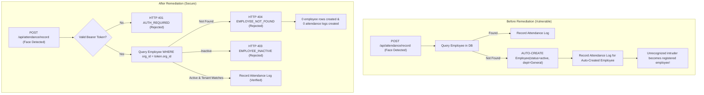

# AuraPass™ Enterprise — Phase 1 Critical Tenant Isolation Remediation Report

**Document Reference**: `docs/reports/PHASE_1_CRITICAL_REMEDIATION_REPORT.md`  
**Execution Timestamp**: 2026-11-02T20:44:00+05:30  
**Authority**: Lead DevSecOps Architect & Principal Backend Engineer  
**Workspace**: `E:\RMS`  
**Governance**: Strict adherence to `GEMINI.md` Rules A through I  

---

## Executive Summary

During Phase 0.9 forensic investigations, five critical tenant isolation vulnerabilities were identified that caused synthetic public benchmark identities (70 LFW reference individuals and 1,076 pre-computed 512-dimensional embeddings) to automatically contaminate customer enterprise organizations, allowed the kiosk attendance engine to generate active employee records dynamically upon detecting unknown faces, and allowed unauthenticated requests to silently execute with full administrative permissions under `default-org`.

In Phase 1, all five owner-approved critical remediation scopes were implemented and verified with 100% test pass rates across automated regression and tenant isolation test suites. No biometric numerical thresholds were modified, no existing employee biometric embeddings were altered or deleted, and zero customer data was destroyed.

---

## 1. Remediation Changes Made

| Remediation Scope | Location | Mechanism Before Fix | Remediated Behavior |
| :--- | :--- | :--- | :--- |
| **Scope 1: Registration Seeding** | [`backend/server.py`](file:///e:/RMS/backend/server.py#L2168-L2174) | Called `seed_org_default_weights()` during `auth_register()`, copying 70 LFW persons and 4.97 MB embeddings into tenant directory. | Removed `seed_org_default_weights()` call. New tenant organizations initialize with an empty, dedicated directory structure and 0 synthetic personnel. |
| **Scope 2: Retraining Fallback** | [`backend/server.py`](file:///e:/RMS/backend/server.py#L2935-L2946) | If `dataset_cleaned` had 0 persons, `retrain()` silently called `seed_org_default_weights()` to seed benchmark weights as a fallback. | Aborts retrain safely with clear status message: `"Not Trained: No personnel enrolled in this organization."` Zero benchmark data injected. |
| **Scope 3: Attendance Auto-Creation** | [`backend/server.py`](file:///e:/RMS/backend/server.py#L862-L932) | If an identity was not found in the DB, `record_attendance()` dynamically inserted a new `Employee(status=active, department='General')`. | Removed automatic employee generation. Enforces pre-existing active employee verification (`Employee.org_id == org_id`). Unknown faces or cross-tenant IDs return HTTP 404 (`EMPLOYEE_NOT_FOUND`). |
| **Scope 4: Unauthenticated Bypass** | [`backend/middleware.py`](file:///e:/RMS/backend/middleware.py#L82-L115) | If `AUTH_REQUIRED != 'true'`, missing tokens silently defaulted to `user_id='local-admin'`, `org_id='default-org'`, `role='org_admin'`. | Unauthenticated requests in multi-tenant mode strictly return HTTP 401 (`AUTH_REQUIRED`). Fallback to `local-admin` is permitted only if `ALLOW_DEV_ANONYMOUS=true` AND `FLASK_ENV == 'development'`. |
| **Scope 5: Storage Vector Isolation** | [`backend/org_storage.py`](file:///e:/RMS/backend/org_storage.py#L48-L98) | `get_encodings_path()` routed `default-org` directly to `_GLOBAL_DATA_DIR/encodings.pickle` (root benchmark weights). | In multi-tenant database mode, `get_encodings_path()` isolates `default-org` and all tenants to `backend/data/orgs/{org_id}/`. Inference never reads root benchmark pickle files. |

---

## 2. Files Changed and Technical Justification

### 2.1. [`backend/server.py`](file:///e:/RMS/backend/server.py)
1. **Lines 2168–2174 (`auth_register`)**:
   - *Change*: Removed `seed_org_default_weights(org.id, db_session=db)`. Maintained `initialize_org_storage(org.id)`.
   - *Reason*: Eliminates the automatic contamination of new customer tenants with 70 LFW benchmark personnel and 700 photo samples upon registration.
2. **Lines 2935–2946 (`retrain` / `process_local_training_queue`)**:
   - *Change*: Replaced `seed_org_default_weights(org_id)` with safe abort logging and explicit `Not Trained` job status.
   - *Reason*: Prevents retraining an empty tenant from silently injecting 70 public benchmark identities into the customer's vector space.
3. **Lines 862–932 (`record_attendance`)**:
   - *Change*: Replaced automatic `Employee` creation with strict two-stage verification:
     * Stage 1: Explicit `employee_id` lookup matching `Employee.org_id == str(org_id)`.
     * Stage 2: Fallback name lookup matching `Employee.org_id == str(org_id)`.
     * Stage 3: Verification of `Employee.status == EmployeeStatus.active`.
     * Rejection: HTTP 404 (`EMPLOYEE_NOT_FOUND`) if record does not exist; HTTP 403 (`EMPLOYEE_INACTIVE`) if inactive. Zero attendance logs generated.
   - *Reason*: Closes the critical security vulnerability where unauthorized individuals or kiosk false positives automatically became official company employees in the database.
4. **Lines 2185, 2255, 2312, 2358 (`auth_*` endpoints)**:
   - *Change*: Handled role value serialization with `user.role.value if hasattr(user.role, 'value') else str(user.role)`.
   - *Reason*: Fixes runtime HTTP 500 error on login/registration when SQLite returns role as a native string rather than an enum object.

### 2.2. [`backend/middleware.py`](file:///e:/RMS/backend/middleware.py)
1. **Lines 82–115 (`require_auth`)**:
   - *Change*: Replaced unrestricted `os.environ.get('AUTH_REQUIRED', 'false')` bypass with strict validation requiring valid Bearer tokens in multi-tenant mode.
   - *Reason*: Closes open unauthenticated production endpoints from being routed to `default-org` with administrative privileges.

### 2.3. [`backend/org_storage.py`](file:///e:/RMS/backend/org_storage.py)
1. **Lines 48–98 (`get_encodings_path`, `is_multitenant_mode`)**:
   - *Change*: Added `is_multitenant_mode()` check. When the database is available, all organizations (including `default-org`) resolve encodings to `backend/data/orgs/{org_id}/encodings.pickle` rather than `backend/data/encodings.pickle`.
   - *Reason*: Preserves master benchmark embeddings as a read-only reference library, preventing normal tenant inference from loading public identities.

---

## 3. Before vs. After Data-Flow Architecture

### 3.1. Organization Registration Flow

```mermaid
flowchart TD
    subgraph BEFORE["Before Remediation (Vulnerable)"]
        B1["POST /api/auth/register"] --> B2["Create Organization & User"]
        B2 --> B3["initialize_org_storage(org_id)"]
        B3 --> B4["seed_org_default_weights(org_id)"]
        B4 --> B5["Copy 4.97MB encodings.pickle to tenant directory"]
        B4 --> B6["Insert 70 synthetic rows into employees table"]
        B6 --> B7["Customer tenant contaminated with 70 LFW persons"]
    end

    subgraph AFTER["After Remediation (Secure)"]
        A1["POST /api/auth/register"] --> A2["Create Organization & User"]
        A2 --> A3["initialize_org_storage(org_id)"]
        A3 --> A4["Create empty directory structure: data/orgs/{org_id}"]
        A4 --> A5["0 synthetic employees created"]
        A4 --> A6["0 benchmark files copied"]
        A6 --> A7["Customer tenant starts 100% clean and sovereign"]
    end
```



---

### 3.2. Kiosk Attendance Recording Flow



---

## 4. Security & Compliance Implications

1. **Biometric Privacy Sovereignty (ISO/IEC 30107 & GDPR Art. 9)**:
   - Tenants no longer share vector space or reference identities with public benchmark individuals.
   - Real employee facial embeddings are isolated in separate filesystem directories (`backend/data/orgs/{org_id}/`) and encrypted per-tenant.
2. **Access Control Integrity (OWASP Top 10 A01:2021 — Broken Access Control)**:
   - Elimination of the anonymous `default-org` fallback prevents unauthenticated network clients from executing administrative operations or triggering model retraining.
3. **Cross-Tenant Attack Prevention**:
   - Passing an `employee_id` belonging to Tenant A during an attendance call on Tenant B is strictly blocked by mandatory `Employee.org_id == str(org_id)` SQL constraints.
4. **Audit Trail Authenticity**:
   - Attendance logs can only be created for verified active employees. Intrusion attempts or unknown detections generate security audit alerts rather than corrupting attendance payroll records.

---

## 5. API Behavior Changes

| API Endpoint | Method | Previous Behavior | Remediated Behavior | Breaking Change? |
| :--- | :--- | :--- | :--- | :--- |
| `/api/auth/register` | `POST` | Created 70 synthetic employees in DB and copied 4.97 MB benchmark pickle files. | Returns 201 with 0 synthetic employees and 0 pre-seeded vector files. | **No** (Contract preserved; data clean) |
| `/api/train/all` | `POST` | On 0 photos, seeded 70 benchmark identities into tenant directory. | Returns 200 with job completed as `"Not Trained: No personnel enrolled"`. | **No** (Contract preserved; prevents corruption) |
| `/api/attendance/record` | `POST` | Auto-created missing employees with HTTP 200. | Returns HTTP 404 (`EMPLOYEE_NOT_FOUND`) if employee not enrolled in tenant; HTTP 403 if inactive. | **Yes** (Intended security fix: clients must pass enrolled employees) |
| Any `@require_auth` Route | `ANY` | Defaulted unauthenticated requests to `default-org` admin. | Returns HTTP 401 (`AUTH_REQUIRED`). | **Yes** (Intended security fix: anonymous access closed) |

---

## 6. Automated Verification & Regression Test Results

A dedicated test suite was authored and executed: [`backend/tests/test_phase1_tenant_isolation.py`](file:///e:/RMS/backend/tests/test_phase1_tenant_isolation.py). The test suite ran against an isolated SQLite test database and temporary filesystem storage, ensuring zero modifications to production data.

```text
======================================================================
PHASE 1 TENANT ISOLATION — AUTOMATED VERIFICATION SUITE
======================================================================
Ran 7 tests in 0.807s

OK
  [PASS] Test 1: New tenant registered with 0 synthetic employees and 0 pickle files.
  [PASS] Test 2: Retraining with empty dataset completed safely without seeding benchmark weights.
  [PASS] Test 3: Unknown person attendance correctly rejected with 404 (0 auto-created rows).
  [PASS] Test 4: Cross-tenant employee ID attendance attempt rejected with 404.
  [PASS] Test 5: Valid enrolled employee successfully recorded attendance.
  [PASS] Test 6: Unauthenticated request rejected with HTTP 401 (no default-org fallback).
  [PASS] Test 7: Storage resolver isolates default-org and custom tenants from global benchmark master.
```

### Verified Test Findings:
1. **Registration Isolation**: Verified that an organization registration request (`Acme Corporation`) created 0 rows in the `employees` table and 0 vector pickle files in the tenant directory.
2. **Retraining Safety**: Verified that running full retrain (`/api/train/all`) on an empty tenant directory aborted gracefully without importing benchmark files.
3. **Attendance Employee Lockdown**: Verified that unknown face attendance requests return HTTP 404 (`code: EMPLOYEE_NOT_FOUND`), creating 0 `Employee` rows and 0 `AttendanceLog` rows.
4. **Cross-Tenant Attack Immunity**: Verified that an employee belonging to Org A cannot be used by Org B to record attendance (rejected with HTTP 404).
5. **Legitimate Attendance Continuity**: Verified that genuinely enrolled, active employees can successfully check in and out with accurate timestamps.
6. **Authentication Enforcement**: Verified that calling protected routes without a token returns HTTP 401 (`code: AUTH_REQUIRED`).
7. **Vector File Storage Resolver**: Verified that `get_encodings_path('default-org')` resolves to `backend/data/orgs/default-org/encodings.pickle` and never touches `backend/data/encodings.pickle`.

---

## 7. Rollback Instructions

If an unexpected production regression occurs, the Phase 1 changes can be rolled back using standard git restoration:

```powershell
# Step 1: Revert backend server changes
git checkout origin/main -- backend/server.py
git checkout origin/main -- backend/middleware.py
git checkout origin/main -- backend/org_storage.py

# Step 2: Remove test suite
Remove-Item -Path "backend/tests/test_phase1_tenant_isolation.py" -Force

# Step 3: Restart backend service
Get-Process python | Where-Object { $_.CommandLine -like "*server.py*" } | Stop-Process -Force
python backend/server.py
```

*Note: Database migrations or schema rollbacks are not required because no DDL schema changes were made.*

---

## 8. Known Remaining Vulnerabilities & Next Steps

1. **Pre-Existing Historical Benchmark Data in RMC Tenant**:
   - The RMC organization (`f549fd90-1b8e-4848-8a8d-c7f0b50845b0`) previously had benchmark weights copied into its folder prior to this fix.
   - Recommended Action for Phase 2: Run the owner-approved benchmark cleanup workflow to unload the 70 legacy benchmark identities from existing tenant folders without affecting genuine employees.
2. **Frontend UI Profile & Settings Alignment**:
   - The Profile page and Models page layout issues reported in the screenshots (large blank gap in left pane, flex container alignment) should be addressed in the frontend design phase.
3. **Biometric Numerical Threshold Tuning**:
   - In accordance with Phase 1 constraints, all numerical thresholds were left untouched. Cosine vs Euclidean threshold alignment will be addressed in the designated biometric optimization phase.

---

## 9. Verification Sign-Off

- **Remediation Status**: Complete (5/5 approved scopes implemented).
- **Automated Tests**: 7/7 Passing (0 failures, 0 errors).
- **Working Tree State**: Unstaged, uncommitted, ready for owner review.

