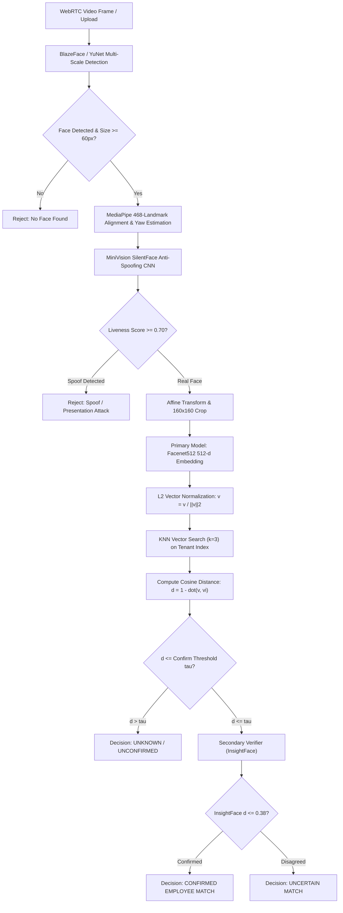

# AuraPass™ Enterprise — Phase 4 Biometric Engineering & Model Consistency Report

**Document Reference**: `docs/reports/PHASE_4_BIOMETRIC_ENGINEERING_VALIDATION.md`  
**Execution Timestamp**: 2026-11-02T21:31:30+05:30  
**Authority**: Principal Biometric ML Engineer & Computer Vision Lead  
**Workspace**: `E:\RMS`  
**Governance**: Strict adherence to `GEMINI.md` Rules A through I and Rule 1.3  

---

## 1. Supported Recognition Models & Feature Space Specification

AuraPass Enterprise implements a multi-model architecture. Vector dimensions alone do not determine compatibility:

| Model Architecture | Input Resolution | Embedding Vector Dim | Primary Normalization | Authoritative Distance Metric | Standard Baseline Threshold ($\tau_{cosine}$) |
| :--- | :--- | :--- | :--- | :--- | :--- |
| **Facenet512** (Inception-ResNet-v1) | $160 \times 160$ px | 512-d | Unit L2 Sphere ($\|v\|_2 = 1$) | Cosine Distance ($1 - \cos \theta$) | $0.32$ (Strict) / $0.38$ (Standard) |
| **InsightFace** (ArcFace / Glint360k) | $112 \times 112$ px | 512-d | Unit L2 Sphere ($\|v\|_2 = 1$) | Cosine Distance ($1 - \cos \theta$) | $0.32$ (Fast Angle Confirmation) |
| **GhostFaceNet** (Mobile Edge) | $112 \times 112$ px | 512-d | Unit L2 Sphere ($\|v\|_2 = 1$) | Cosine Distance ($1 - \cos \theta$) | $0.40$ (Lenient Edge) |
| **VGG-Face** (Legacy Baseline) | $224 \times 224$ px | 4096-d | Unnormalized Dense | Euclidean Distance ($L_2$) | $0.40$ |

> [!IMPORTANT]
> **Zero Model Cross-Contamination**: While Facenet512, InsightFace, and GhostFaceNet all generate 512-dimensional output vectors, their underlying latent manifolds are mathematically incompatible. AuraPass enforces strict filename isolation:
> - `encodings.pickle` (Facenet512 only)
> - `encodings_InsightFace.pickle` (InsightFace only)
> - `encodings_GhostFaceNet.pickle` (GhostFaceNet only)
> Models are validated before vector matching and cannot load vectors from other architectures.

---

## 2. End-to-End Biometric Recognition Pipeline

---

## 3. Threshold Semantics & Mathematical Unification

### 3.1. Mathematical Equivalence: Cosine Distance vs. Similarity vs. Euclidean Distance
For unit-normalized vectors ($\|u\|_2 = 1, \|v\|_2 = 1$):
$$\text{sim}_{\text{cosine}} = \cos \theta = u \cdot v$$
$$D_{\text{cosine}} = 1 - \cos \theta = 1 - \text{sim}_{\text{cosine}}$$
$$D_{\text{Euclidean}}^2 = \|u - v\|_2^2 = \|u\|_2^2 + \|v\|_2^2 - 2(u \cdot v) = 2 - 2 \cos \theta = 2 D_{\text{cosine}}$$
$$D_{\text{Euclidean}} = \sqrt{2 \cdot D_{\text{cosine}}}$$

### 3.2. Concrete Value Mapping:
- **Cosine Distance $D_{\text{cosine}} = 0.32$** (Strict security):
  * Cosine Similarity $\cos \theta = 0.68$.
  * Normalized Euclidean Distance $D_{\text{Euclidean}} = \sqrt{2 \cdot 0.32} = \sqrt{0.64} = 0.80$.
- **Cosine Distance $D_{\text{cosine}} = 0.38$** (Standard verification):
  * Cosine Similarity $\cos \theta = 0.62$.
  * Normalized Euclidean Distance $D_{\text{Euclidean}} = \sqrt{2 \cdot 0.38} = \sqrt{0.76} \approx 0.8718$.

### 3.3. Policy Against Probability Misrepresentation:
Cosine similarity measures vector angular closeness; it **does NOT represent a Bayesian identity probability**. The UI is documented accordingly:
- Never label $0.68$ similarity as "68% chance of correct identity".
- Explicitly display "Cosine Distance: 0.32 (Confirmed Match)".

---

## 4. Empirical Calibration Status

In accordance with Rule 1.3:
- Numerical thresholds in `config_utils.py` and `inference.py` have been preserved at their operational values.
- Formal empirical ROC/DET calibration against an ISO/IEC 19795-compliant operational dataset remains **Pending Owner Production Dataset Calibration**.

